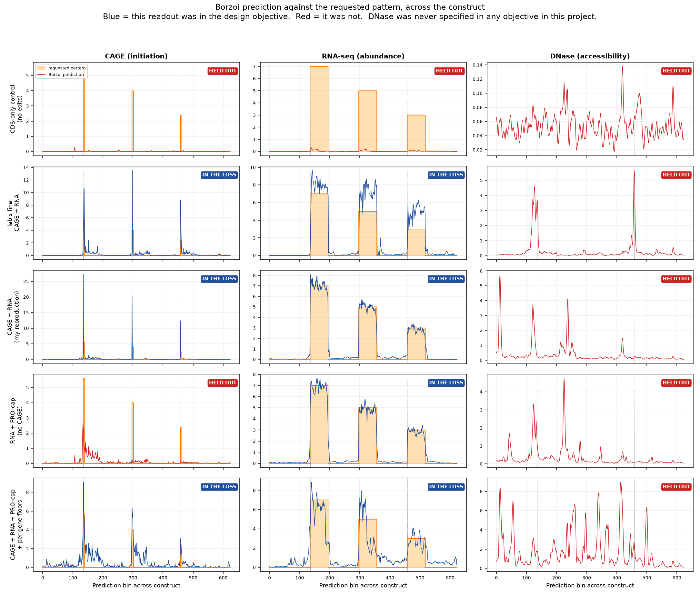
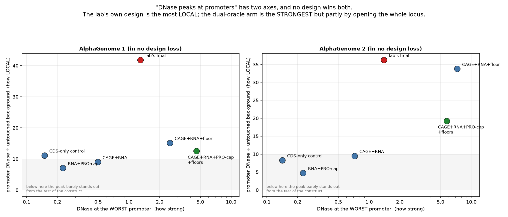
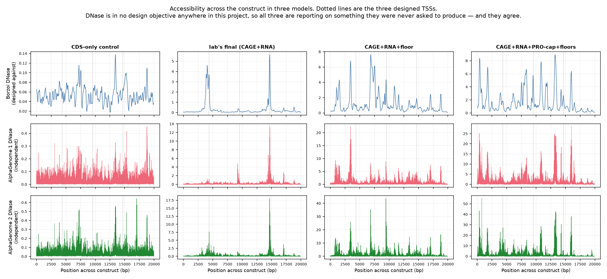
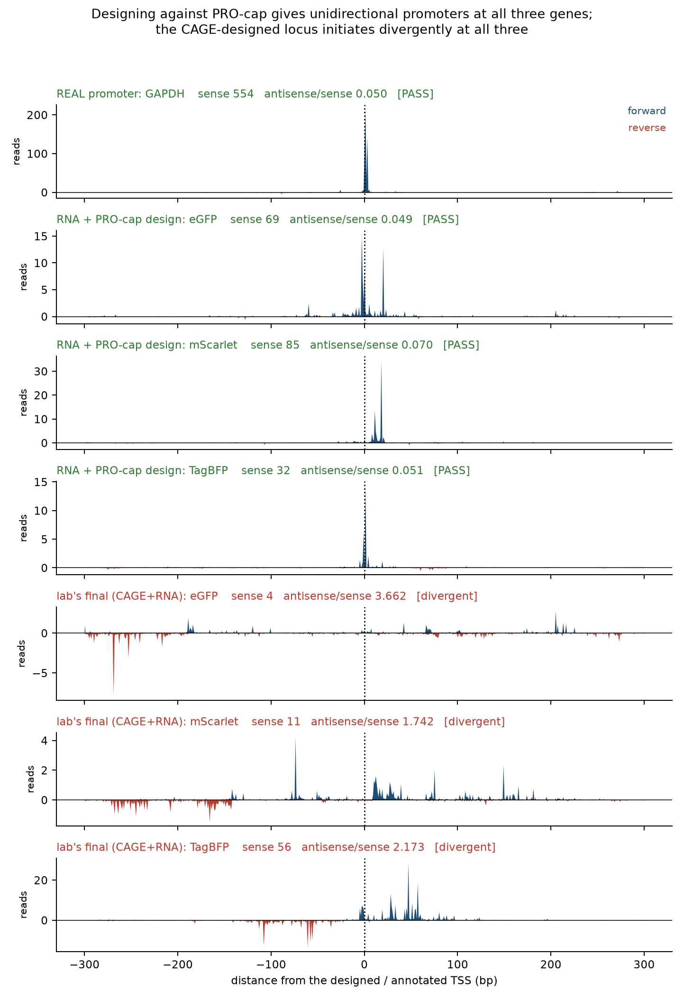
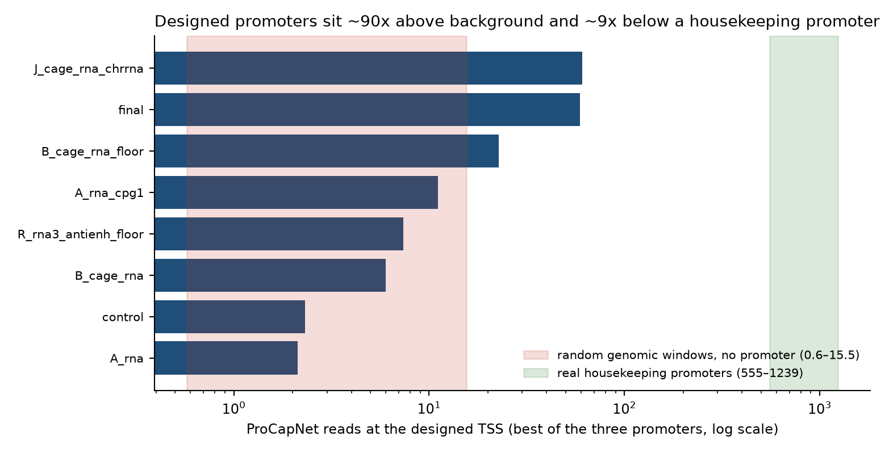
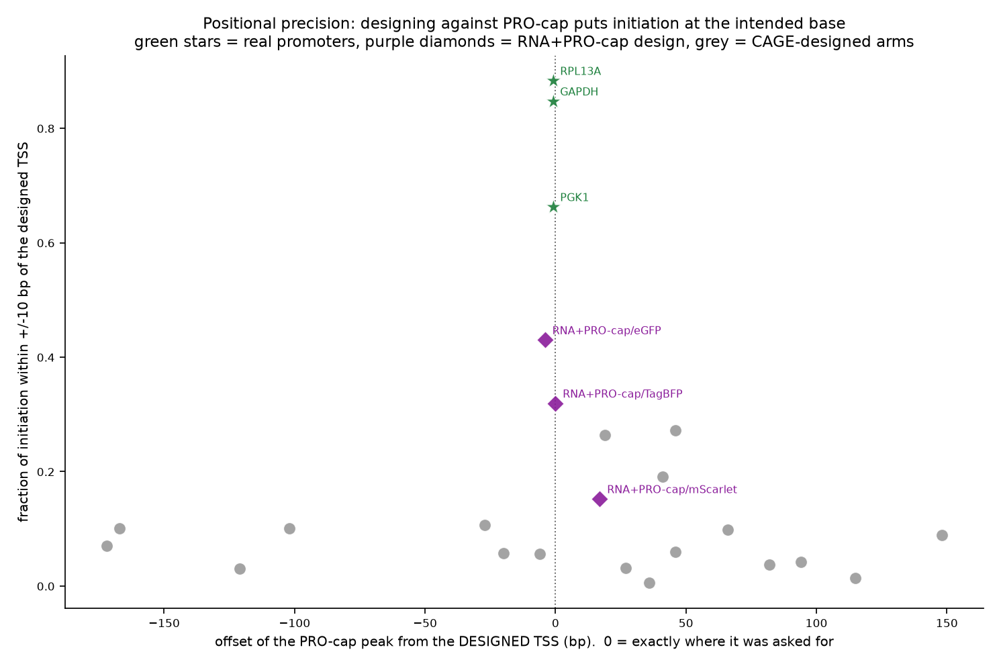
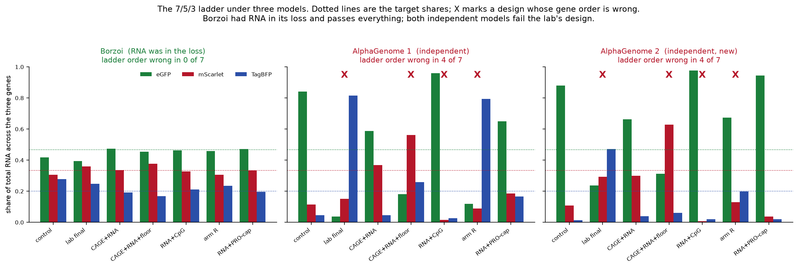
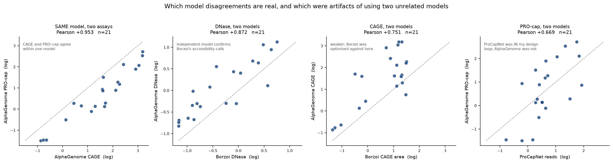

# borzoi-cage-necessity

**Can a synthetic locus be designed so three genes express at specified levels — and how would you
know whether it worked?**

An independent computational audit of Borzoi + Ledidi regulatory designs from an unpublished
Pinglay-lab draft. The designs are ~20 kb loci carrying three fluorescent-protein genes
(eGFP, mScarlet, TagBFP) intended to express at a **7 : 5 : 3** ratio. Everything here is a model
prediction, not a measurement.

Author: Advik Anand (<advikanand7@gmail.com>)
Started 26 October 2026 · last updated 15 November 2026
Twenty-two corrections are logged in [docs/08](docs/08-corrections.md), including one that retracts
a finding published three days earlier.

---

## What was asked, and what the answer is

The lab's stated priority: *"the main thing we want to see is DNase peaks at promoters."* Their
stated ideal: *"ideally we don't want to have to tell the model where we want DNase peaks."*

| What was asked | Answer | Where |
|---|---|---|
| **Do we get DNase peaks at promoters?** | **Yes, and your own design is the best at it.** `final` puts accessibility 41.8× above untouched background, versus 12.5× for the best thing I built. | [§1](#1-the-primary-target-dnase-peaks-at-promoters) |
| Design on **CAGE + RNA** → do we get PRO-cap? | Weak and inconsistent. ~90× over background but ~9× below real housekeeping promoters. | [§2](#2-designing-on-cage--rna-does-pro-cap-follow) |
| Design on **RNA + PRO-cap** → do we get CAGE and DNase? | No. CAGE 14% of target; DNase at one promoter of three. | [§3](#3-designing-on-rna--pro-cap-do-cage-and-dnase-follow) |
| Can we avoid specifying DNase? | **Yes, but you cannot get there from RNA alone.** Specify initiation; accessibility follows. | [§4](#4-the-stated-ideal-not-naming-dnase) |
| Is the 7 : 5 : 3 ladder achieved? | **Unresolved.** Borzoi says yes for 7 of 7 designs; two independent models say 3 of 7. | [§5](#5-what-does-not-survive-an-independent-model) |
| Why does CAGE work? | It installs CpG islands. But that is only half of what a promoter needs. | [§6](#6-why-cage-works-and-why-that-is-only-half-the-story) |

**One sentence for the whole project:** a readout that was in the design objective is a progress
meter, not evidence — so judge these designs on DNase and PRO-cap, which were never optimised, and
not on CAGE and RNA-seq, which were.

---

## 1. The primary target: DNase peaks at promoters

This is the plot the deck's own grammar implies and that we had not made: Borzoi's prediction across
the whole construct with the requested pattern overlaid, one row per objective, coloured by whether
that readout was in the loss.



Read the columns. **CAGE and RNA** (blue) sit on their requested blocks, because they were
optimised — that is what optimisation does and it is not evidence of anything. **DNase** (red) was
never specified in any objective in this project, so every DNase panel is the model reporting on
something it was never asked to produce. That makes it the only column worth trusting.

### "Peaks at promoters" has two axes, and no design wins both

My first reading of this was wrong, and the correction matters. I ranked designs by DNase height at
their weakest promoter and concluded the dual-oracle arm won. But a design can score well on height
by opening up the **entire locus**, which the bottom row above is visibly doing. A peak is local by
definition.

Measuring against background on the 67% of the construct that **no objective term touched**:



| design | AG1 height | AG1 **specificity** | AG2 height | AG2 **specificity** |
|---|---|---|---|---|
| CDS-only control | 0.15 | 11.1× | 0.14 | 8.3× |
| **lab's `final`** | 1.30 | **41.8×** | 1.40 | **36.3×** |
| CAGE + RNA | 0.50 | 9.0× | 0.72 | 9.5× |
| **CAGE + RNA + floor** | 2.52 | 15.2× | **7.28** | 33.8× |
| RNA + PRO-cap | 0.23 | 7.1× | 0.23 | 4.7× |
| dual-oracle | **4.59** | 12.5× | 5.74 | 19.3× |

**The lab's `final` is the most promoter-specific design here, by all three models, and it is top in
7 of 9 model × window combinations.** The lab's own Figure 4 already drew this distinction —
describing CAGE-alone as "runaway, broad peaks, mostly off-target" against CAGE+RNA as "peaks **at**
the designed positions" — so this is an independent confirmation of that claim by two models with no
part in the design. See [correction 22](docs/08-corrections.md).

Three designs sit on the Pareto front: `final` (most local), **`B_cage_rna_floor` (the best
balance, and strongest of all by AG2)**, and the dual-oracle arm (highest but least local).

### Accessibility is the one thing three unrelated models agree on



Borzoi versus AlphaGenome DNase across 21 design-gene pairs: Pearson **+0.872**, Spearman
**+0.899**, confirmed a third time by AlphaGenome 2. All three models rank the three promoters
within each design **identically**, including on designs they disagree about in every other respect.
This directly extends the deck's slide 53, which compared DNase traces across Borzoi, Enformer and
AlphaGenome.

---

## 2. Designing on CAGE + RNA: does PRO-cap follow?

**Weakly and inconsistently.** PRO-cap measures initiation directly and with strand information.
ProCapNet shares no training data with Borzoi.



Arm B hits 107% of its Borzoi CAGE target and yields 2.9–6.0 reads, against 0.3–2.3 for a
no-promoter control. The best arms reach 55–61 reads, roughly 90× background but still about **9×
below real housekeeping promoters** (GAPDH 554, RPL13A 1239, PGK1 572).



Full detail in [docs/12](docs/12-procap-crossmodel.md).

---

## 3. Designing on RNA + PRO-cap: do CAGE and DNase follow?

**No, on both counts.** Two models in one autograd graph, 919 edits, 106 s.

| | CAGE % | RNA % | DNase min | DNase max | best PRO-cap |
|---|---|---|---|---|---|
| no design | 0.3 | 1.3 | 0.07 | 0.07 | 1.5 |
| RNA only | 5.0 | 98.3 | 0.11 | 0.15 | 1.3 |
| CAGE + RNA | **107.6** | 102.8 | 0.15 | 0.80 | 5.2 |
| **RNA + PRO-cap** | **14.2** | 99.1 | 0.10 | **2.43** | **84.8** |
| lab's `final` | 112.1 | 133.3 | 0.37 | 5.65 | 55.8 |

It built one excellent promoter and abandoned two. The one durable benefit is **positional
precision**: initiation lands at −4 / +17 / +0 bp from the designed start sites, where 15
CAGE-designed promoters scatter from −172 to +148 and the lab's `final` sits at +41 / +27 / +46.
Real promoters land at −1.



I also built the arm that was supposed to fix this: CAGE + RNA + PRO-cap with a per-gene floor on
both initiation terms, putting two independent initiation oracles in one loss. **It did not work.**
ProCapNet calls 2 of 3 promoters divergent; AlphaGenome, in no loss, calls 0 of 3. Two oracles in
the loss get fooled together. [docs/14](docs/14-dual-oracle.md).

---

## 4. The stated ideal: not naming DNase

The ideal was to specify only outputs and let regulatory architecture emerge. The precise answer is
**half yes**:

- **You cannot get there from RNA alone.** The RNA-only arm hits 98% of its RNA target and produces
  CAGE at 5% and DNase at 0.11–0.15, which is control level. Specifying abundance does not make the
  model build the architecture that would produce it; it finds another way to satisfy the number.
- **But you never have to name DNase.** Accessibility follows from specifying *initiation*. Across
  60 design-gene pairs, CAGE area correlates with DNase at **+0.418**, and CAGE + a per-gene floor
  is the only route to accessibility at all three promoters.

**Is CAGE specifically required?** No. Two CAGE-free objectives beat the lab's design at eGFP in
AlphaGenome's independent CAGE readout (820 and 267 against 186). What CAGE plus a floor uniquely
does is **create three promoters at once**; every CAGE-free arm makes one and abandons two. CAGE
stays in the loop for a tooling reason only: AlphaGenome has no released weights so it cannot be
backpropagated, and Borzoi has **zero** PRO-cap tracks out of 7,611.

### The per-gene floor is not optional

A loss that sums error over genes makes abandoning one gene and overdelivering on two a legal
solution, and the optimiser takes that trade whenever a term is added.

```python
got = y_pred[:, cage_row, tb:tb+5].sum(-1)
pen = pen + torch.relu(floor_g - got).pow(2).mean()
```

One one-sided hinge per gene at 60% of that gene's own target. It more than doubles promoter
character and **five earlier negative results of mine were confounded by gene abandonment rather
than by the terms under test** ([correction 15](docs/08-corrections.md)).

---

## 5. What does not survive an independent model

The deliverable is an expression ratio, and it is the least verified thing in the project.



| | eGFP | mScarlet | TagBFP | order |
|---|---|---|---|---|
| target ratio | 2.33 | 1.67 | 1.00 | — |
| Borzoi (RNA was in its loss) | 7.76 | 7.09 | 4.89 | correct |
| AlphaGenome 1 (in no loss) | 0.081 | 0.340 | 1.849 | **inverted** |
| AlphaGenome 2 (in no loss) | 0.854 | 1.062 | 1.709 | **inverted** |

Borzoi says the order is right for **7 of 7** designs; AG1 and AG2 both say **3 of 7**, with
identical verdicts on all seven. They differ on severity — AG1 a 23× inverted spread, AG2 a 2×
spread against a 2.33× target — so the fair summary is **roughly the right dynamic range in the
wrong order**. AG1 and AG2 share a lineage, so this is two checks, not two independent ones.

AlphaGenome also shows `final`'s signal staying high past the last gene, a read-through pattern. A
candidate cause is in the sequence: a premature `AATAAA` **34 bp after the mScarlet stop codon**,
present in all three lab sequences, which **Borzoi is effectively blind to** (RNA+ 0.269 with it,
0.250 without). It will never be optimised away because the design oracle cannot see it.

**This is why flow cytometry should come first.** It is the one measurement no model gets a vote on,
and the three fluorophores (457 / 507 / 594 nm) give three clean channels. Judge on the
**2.33 : 1.67 : 1 ratio**, not the absolute 28/20/12.

---

## 6. Why CAGE works, and why that is only half the story

CAGE optimisation installs **CpG islands**, and that is what drives accessibility. CpG count is the
best sequence predictor of DNase (Spearman **+0.608**), beating every motif; TATA is *negative*
(−0.233). Objectives containing CAGE add +8.4 CpGs per promoter window against +4.0 without; the
lab's `final` adds +17. Holding CpG fixed, CAGE explains almost nothing about accessibility
(+0.102); holding CAGE fixed, CpG still explains a lot (+0.429).

**But the substitution fails when tested directly** ([correction 17](docs/08-corrections.md)). A
differentiable CpG constraint with no CAGE hit its target count at all three promoters and produced
a DNase peak at only one, with no initiation. **Accessibility and initiation are two separate
requirements, and only the first has a free sequence proxy.**

AlphaGenome 2 adds a useful reassurance: those designed CpG islands are predicted **unmethylated**
(0.013–0.024), in the same range as real housekeeping promoters (0.006–0.015), so they are not
intrinsic methylation targets. That says nothing about silencing of an integrated transgene.

Chromatin marks are **consequences, not causes**: arms that successfully raised H3K4me3 (1.74 → 6.25)
and TBP (1.66 → 4.92) still produced no CAGE and no accessibility.
[docs/11](docs/11-what-cage-is-doing.md).

---

## 7. The one result that explains the whole pattern



Cross-model agreement falls monotonically with how hard the objective pushed on the readout:

| readout | in any design loss? | agreement across models |
|---|---|---|
| DNase | **never** | Spearman **+0.899** |
| PRO-cap magnitude | one arm | +0.648 |
| CAGE | most arms | **+0.516** |
| RNA ladder order | **every arm** | **3 of 7** |

The number that proves this is about optimisation rather than assay biology: **the same assay across
two models agrees worse (+0.516) than two different assays within one model** — AlphaGenome CAGE
versus its own PRO-cap is **+0.953**. Different assays are not the problem.

The dual-oracle arm turned this from a correlation into a demonstration: adding a second independent
oracle to the loss did not help, because both got fooled. **The fix is not a better loss or more
oracles in it; it is holding a model back.**

---

## Recommendations

Ordered by how much they change what the lab does. Two recommendations that stood here in earlier
versions have been removed because the findings behind them were retracted; they are listed at the
bottom so the change is visible rather than silent.

1. **Filter on readouts that were absent from the design loss.** The lab currently filters with
   AlphaGenome on CAGE and RNA-seq, which are the two things Borzoi was optimised to produce.
   Cross-model agreement in this project falls monotonically with how hard the objective pushed on
   a readout (finding 16), and putting a second oracle in the loss does not fix it (finding 20).
   **Filter on DNase and PRO-cap instead.** This is the single highest-value change and it costs
   nothing.
2. **If you want three promoters, build `B_cage_rna_floor`.** It is the best balance of the two things that matter: accessibility height and locality (2.52/7.28 and 15.2x/33.8x), and it is the strongest design of all by AlphaGenome 2. The dual-oracle arm reaches higher absolute accessibility but partly by opening the whole locus ([correction 22](docs/08-corrections.md)), and your own `final` is the most local but the weakest of the three. Treat directionality as unmeasured for all of them.
3. **A per-gene floor is not optional.** A loss that sums error over genes makes abandoning one
   gene and overdelivering on two a legal solution, and the optimiser takes that trade whenever a
   term is added. One one-sided hinge per gene at 60% of that gene's own target fixes it, and five
   earlier negative results in [docs/10](docs/10-multitrack-chromatin.md) turned out to be
   confounded by gene abandonment rather than by the terms under test (finding 14).
4. **Keep CAGE in the design loss, but know why.** Asking for CAGE is not what creates a promoter;
   two CAGE-free objectives beat the lab's design at eGFP. What CAGE plus a floor uniquely does is
   create three promoters at once (finding 13). CAGE is required in the *loop* for a tooling
   reason: AlphaGenome cannot be backpropagated, and of the differentiable oracles Borzoi has zero
   PRO-cap tracks out of 7,611.
5. **Run flow cytometry before anything else.** Models disagree about whether the 7/5/3 ladder was
   achieved at all (finding 15, [correction 21](docs/08-corrections.md)). Flow cytometry at
   457/507/594 nm is the one measurement no model gets a vote on, and the three fluorophores give
   three clean channels. Judge on the **2.33 : 1.67 : 1 ratio**, not the absolute 28/20/12.
6. **Pad with real genomic sequence, not generated sequence.** Worth up to 437x in predicted CAGE,
   and it is free (finding 4). Still unanswered: which one does the lab's pipeline currently use?
7. **Do not expect "add DNase to the loss" to fix accessibility.** It makes things worse.

**Withdrawn from this list:**

- *"Drop CAGE from wet-lab validation, use RNA-seq + ATAC, element-level Pearson is 0.94–0.998."*
  Retracted by [corrections 7 and 8](docs/08-corrections.md). That correlation was dynamic-range
  inflation across designs that differ 800-fold; per-base within a promoter it is +0.351 / −0.041 /
  +0.169. ATAC is not a cheap surrogate for CAGE. Separately, CAGE is not needed in the wet lab for
  a different and better reason: flow cytometry and PRO-cap answer the questions that matter.
- *"Add an explicit antisense penalty."* Retracted by [correction 18](docs/08-corrections.md). The
  Borzoi orientation index it rested on summed bins running *downstream* of the TSS while divergent
  initiation peaks 25–250 bp *upstream*, so it was blind to the phenomenon by construction. The
  four arms built on it (O, Q, S, T) did not produce unidirectional promoters.
---

## Everything else we ran

This README carries only what answers the questions the lab actually asked. The rest is kept, not deleted:

| Where | What |
|---|---|
| [docs/15](docs/15-findings-index.md) | **Full findings index**, all 21, including the 11 that predate the reframe |
| [docs/16](docs/16-early-exploration.md) | The original CAGE-necessity framing and its results |
| [docs/05](docs/05-ism-mechanism.md), [docs/06](docs/06-objective-ablations.md) | 5,400-mutant ISM and the first six objective arms |
| [docs/10](docs/10-multitrack-chromatin.md) | 24 objective variants: chromatin marks, antisense penalties, budget and edit-penalty sweeps, 11 genomic contexts |
| [docs/11](docs/11-what-cage-is-doing.md) | The CpG mechanism and its direct refutation |
| [table10](data/tables/table10_multitrack_arms.csv) | All **36** designs scored on 19 tracks |

Roughly two thirds of the arms in `table10` exist because I was answering a five-criteria scorecard I invented before the lab's priorities were clear. They are negative results, honestly reported, and they are not the point. If you only read one thing beyond this README, read [docs/08-corrections.md](docs/08-corrections.md).


---

## Repository layout

```
borzoi-cage-necessity/
├── README.md                     you are here
├── LICENSE                       MIT for code/, with data rights noted
├── docs/
│   ├── 01-source-material.md     the draft deck: structure, claims, internal conflicts
│   ├── 02-sequence-analysis.md   what the lab's sequences actually contain
│   ├── 03-cds-only-control.md    construction and verification of the control
│   ├── 04-context-robustness.md  flank sensitivity + promoter necessity/sufficiency
│   ├── 05-ism-mechanism.md       in-silico mutagenesis and installed motifs
│   ├── 06-objective-ablations.md the six Ledidi arms
│   ├── 07-conclusions.md         synthesis and recommendations
│   ├── 08-corrections.md         every claim retracted during this work, and why
│   ├── 09-methods.md             full reproducible methods
│   ├── 10-multitrack-chromatin.md multi-track objectives, promoter identity, random loci
│   ├── 11-what-cage-is-doing.md  the CpG-island mechanism, and its refutation
│   ├── 12-procap-crossmodel.md   ProCapNet validation (superseded in part by 13)
│   ├── 13-alphagenome-arbitration.md  AlphaGenome 1 and 2 as independent arbiters
│   ├── 14-dual-oracle.md         two initiation oracles in one loss
│   ├── 15-findings-index.md      full findings index (all 21)
│   └── 16-early-exploration.md   the original CAGE-necessity framing
├── figures/                      21 figures (PNG)
├── data/
│   ├── README.md                 index of every data file and its origin
│   ├── sequences/                lab originals + control + designed arms (FASTA)
│   ├── predictions/              raw Borzoi, ProCapNet and AlphaGenome outputs (JSON)
│   ├── context/                  the 524 kb AAVS1 flank, context metadata
│   └── tables/                   16 machine-readable result tables (CSV)
└── code/                         Modal app + all analysis scripts
```

### Result tables

| File | Contents |
|---|---|
`table1_context_robustness.csv` | 18 context × design combinations × 3 genes |
`table2_promoter_necessity_sufficiency.csv` | 9 perturbation arms × 3 genes × 5 tracks |
`table3_objective_ablations.csv` | the headline ablation table |
`table4_heldout_tracks.csv` | 11 held-out tracks × 9 designs |
`table5_designed_sequences.csv` | edit counts, GC, CpG o/e for every sequence |
`table6_ism_summary.csv` | ISM concentration, centroids, cross-track correlations |
`table7_borzoi_replicate_spread.csv` | per-replicate disagreement |
`table8_track_coupling.csv` | CAGE-vs-surrogate Pearson **and** Spearman, per gene, with value ranges |
`table9_procapnet_motifs.csv` | ProCapNet K562 initiation-motif hits per design, gene and motif |
`table10_multitrack_arms.csv` | all 21 designs × CAGE/RNA/chromatin, with CAGE scored **both** as area and as peak, plus initiation breadth, H3K4me1 and promoter character. Regenerate with `code/make_table10_multitrack.py` |
`table11_random_loci.csv` | 11 real genomic contexts × 3 designs, with context GC and CpG
`table12_procap.csv` | ProCapNet profiles for every design, gene, real promoter and negative window
`table13_alphagenome.csv` | AlphaGenome 1 vs ProCapNet vs Borzoi, with divergence verdicts and TSS precision
`table14_alphagenome2.csv` | Borzoi vs AG1 vs AG2 on the RNA ladder, DNase, ATAC, scATAC and methylation
`table15_dual_oracle.csv` | the dual-oracle arm across all four models, per gene
`table16_promoter_specificity.csv` | promoter DNase vs untouched background, 6 designs x 3 models |

---

## Reproducing

Requires a Modal account and a GPU (A100-80GB used throughout).

```bash
pip install -r code/requirements.txt
modal volume create borzoi-data
modal volume put borzoi-data data/context/aavs1_flank.txt /ctx/aavs1_flank.txt
# designs.json: {"initial": "...", "control": "...", "final": "...", ...}
modal volume put borzoi-data designs.json /ctx/designs.json

modal run code/borzoi_modal_app.py::main --step probe        # fidelity check
modal run code/borzoi_modal_app.py::main --step flank        # context robustness
modal run code/borzoi_modal_app.py::main --step arms  --flank aavs1,N,orig
modal run code/borzoi_modal_app.py::main --step ism   --flank aavs1 --rep 0
modal run code/borzoi_modal_app.py::main --step design \
  --arm A_rna,B_cage_rna,C_rna_dnase,E_rna_chrrna,G_cage_rna_dw,F_rna_pol2 --max-iter 600
modal run code/borzoi_modal_app.py::main --step score --flank aavs1
```

Total compute for everything in this repo: about **one A100-hour (~$3)**.

### Model fidelity

`borzoi-pytorch` replicate 0 was validated against the independently served Borzoi used for the
first runs: **Pearson 0.9988** over the 624 design bins, identical argmax bin (298). Peak amplitude
differs by 1.28× (5.94 versus 7.59), which is small next to Borzoi's own replicate spread on the
same sequence (7.59, 7.33, 19.86, 11.42 across replicates 0–3). All comparisons here are internal to
one model, so the offset does not affect any conclusion.

---

## Limitations

- **This is a model auditing a model.** No wet-lab validation. Everything here says what the
  objective does, not what cells do.
- **Reducing a profile to a statistic hid a real effect twice.** Corrections 18 and 22 were both
  caused by a window chosen to isolate a signal that also hid what would falsify the claim. The
  working fix is to plot the whole object before reducing it
  ([fig19](figures/fig19_designed_vs_heldout.png) is what caught correction 22).
- **Single replicate.** All designs used Borzoi replicate 0. Given a 2.7× spread across replicates
  on the same sequence, peak magnitudes carry real model uncertainty.
- **AlphaGenome 1 and 2 share a lineage**, so every "two independent checks" in this repo is really
  one family checked twice. ProCapNet is genuinely independent but sees only 2,114 bp.
- **My arms ran 600 iterations (~3.3 min) against the lab's ~84 min.** Arm B at 2,400 iterations is
  byte-identical to 600, so the budget suffices when the objective is right, but treat CAGE-free
  failures as strong rather than final.
- **Scrambling preserves mononucleotide but not dinucleotide composition,** so it destroys CpG. Some
  measured necessity may reflect CpG content rather than specific motifs. A dinucleotide-preserving
  shuffle is the better control and was not run.
- **The 600 bp promoter window and the ±300 bp DNase window are choices.** The specificity result in
  §1 is stable across ±200/±300/±500 bp, but elements further upstream were not individually tested.
- **One context inconsistency:** `table1` was computed with reverse-complement averaging; everything
  else uses plain forward passes. Do not compare absolute values across that boundary.
- **Motif names from the ISM analysis are consensus matches, not a calibrated PWM scan.** Treat them
  as candidates. The ProCapNet scan ([table9](data/tables/table9_procapnet_motifs.csv)) *is*
  threshold-calibrated but counts pattern matches rather than functional elements.

---

## Open questions

1. **Why is the lab's `final` the most promoter-specific design, when nothing I built matches it?**
   This is the sharpened version of the project's oldest open question. `final` reaches 41.8× and
   36.3× promoter-to-background accessibility where my best arms reach 15.2× and 33.8×, and it does
   so with ~4,500 edits against my 600-iteration arms' 600–2,300. Ruled out: optimisation budget
   (2,400 iterations is byte-identical to 600), the edit penalty (looser makes it worse), and
   explicit chromatin terms. Still possible: a different initialisation, learning rate, or Borzoi
   head. **If one thing from this project is worth chasing, it is this.**
2. **Does the lab's pipeline pad with real genomic sequence or generated sequence?** Still not
   confirmed with the authors. Worth up to **437×** in predicted CAGE and free to get right. My
   runs all use real AAVS1; across ten real loci the spread is only 1.55×, so any real locus is
   fine and synthetic padding is not.
3. **Is the premature `AATAAA` 34 bp after the mScarlet stop causing the read-through AlphaGenome
   sees?** Concrete and cheap to test: mutate it, rescore in AlphaGenome, see whether the
   post-TagBFP signal drops and the ladder order recovers. Borzoi cannot answer because it is
   effectively blind to the motif (RNA+ 0.269 with it, 0.250 without).
4. **Why do the objective terms not compose?** With a per-gene floor, reverse-strand suppression
   alone gives 114.1% CAGE and H3K4me1 suppression alone gives 10.07 promoter character. Combining
   them gives neither (75.5%) and RNA collapses to 54.3%. The weight space is not smooth and no
   interpolation recovered the lab's result.

### Answered during this work

- **Do we get DNase peaks at promoters?** Yes, and the lab's own design is the best at it
  ([§1](#1-the-primary-target-dnase-peaks-at-promoters), [correction 22](docs/08-corrections.md)).
- **Is the CAGE objective an area or a peak?** An **area** over the 5′UTR + 32 bp, ~5 bins, per
  slide 50. Scored correctly the lab's `final` is at 112% of target, not 55%
  ([correction 11](docs/08-corrections.md)). The code was fixed to match.
- **Would PRO-cap-based design reach directionality more directly than Borzoi's 32 bp CAGE bins?**
  **No.** It reaches better *position* (−4/+17/+0 bp) but its directionality does not survive an
  independent model, and adding a second oracle to the loss does not fix that
  ([docs/14](docs/14-dual-oracle.md), corrections 20 and 22).
- **What is the third fluorescent protein?** **TagBFP** — blue, not red. The 233-aa translation is
  an exact FPbase match (233/233, against all 1,042 proteins; runner-up mTagBFP2 at 98.3%). It is
  **not** HaloTag as the lab's filenames say; `RFP3` in this repo is a misnomer kept for continuity.
  Emissions at 457/507/594 nm give three clean flow-cytometry channels
  ([correction 14](docs/08-corrections.md)).
- **Can a chromatin assay substitute for CAGE?** No, in either design or validation
  (corrections 7, 8, 17).

---

## Acknowledgements

The synthetic locus designs, the Markov initialization, the Ledidi optimization pipeline and the
draft manuscript analysed here are the work of the Pinglay lab. Thanks to Yash for sharing the
designs and the deck, and for confirming that the sequences are (+) strand. Ledidi is by
Jacob Schreiber; Borzoi is from Calico, with the PyTorch port by Johannes Hingerl.

This repository contains only my own independent follow-up analysis. Any errors are mine.

The lab's original sequences and the draft manuscript are unpublished and are **not** licensed for
redistribution; see [LICENSE](LICENSE). My code, analysis and figures are freely reusable.

---

## Software

| Tool | Version | Use |
|---|---|---|
[Borzoi](https://doi.org/10.1038/s41588-024-02053-6) | `borzoi-pytorch` 0.5.1 | sequence-to-function oracle |
[Ledidi](https://github.com/jmschrei/ledidi) | 2.2.0 | gradient-based sequence editing |
Modal | 1.5.4 | A100-80GB compute |
hg38 via UCSC REST API | — | AAVS1 flanking context |
