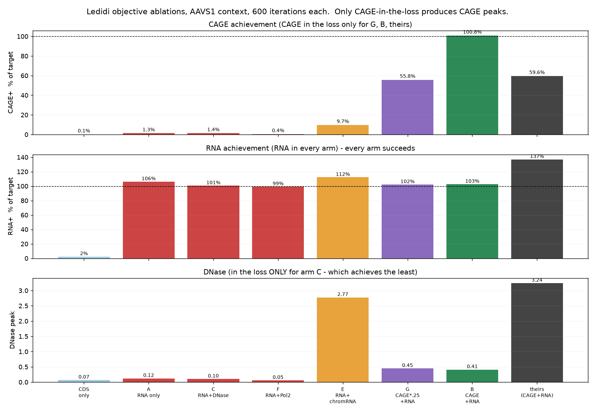
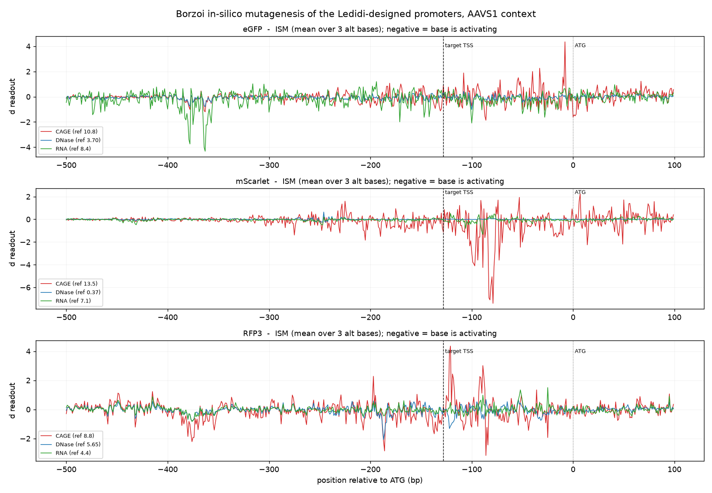

# borzoi-cage-necessity

**Is CAGE actually required to design synthetic gene-expression programs, or can RNA-seq alone do it?**

An independent computational audit of Borzoi/Ledidi regulatory sequence designs, built to answer one
question: when a design pipeline optimizes a sequence against both CAGE and RNA-seq predictions,
is the CAGE term doing necessary work, and can it be dropped or replaced with something cheaper?

Author: Advik Anand (<advikanand7@gmail.com>)
Date: 26 October 2026
Status: complete for the questions below; two items still open (see [Open questions](#open-questions))

---

## TL;DR

Twenty findings, in rough order of importance. Findings 12-18 answer the mechanistic question the authors actually posed and the two cross-model questions they asked next. Findings 19-20 come from the final arm, which was built to fix a failure the earlier findings had diagnosed: it fixed the half that was an allocation problem and left the half that was an overfitting problem exactly where it was.
> **Reading the numbers below.** Every "% of CAGE target" in this README is a **peak height** in a
> 10-bin window at the TSS. The source deck's slide 50 implies the objective is an **area** over
> ~160 bp. The choice matters: the lab's `final` is at 55% of target as a peak and **112% as an
> area**. See [correction 11](docs/08-corrections.md). Area readouts are in
> [table10](data/tables/table10_multitrack_arms.csv).

| # | Finding | Evidence |
|---|---|---|
| 1 | **CAGE is necessary in the design loss and nothing substitutes for it.** RNA-only reaches 1.3% of the CAGE target; CAGE+RNA reaches 100%. Substituting DNase (1.4%), Ser5-P Pol II (0.4%), chromatin RNA (12.1%) or **six chromatin marks jointly (1.5%)** all fail. | [Ablations](docs/06-objective-ablations.md), [multi-track](docs/10-multitrack-chromatin.md) |
| 2 | **But CAGE is free at design time.** Borzoi predicts all 7,611 tracks in one forward pass, so a CAGE term costs nothing. CAGE only costs money if you *measure* it. The two questions had been conflated. | [Conclusions](docs/07-conclusions.md) |
| 3 | **No chromatin assay substitutes for CAGE in validation either.** Within one design family CAGE and DNase co-collapse (Pearson +0.942 to +0.998), but across designs from different objectives that drops to +0.218, and among CAGE-containing designs it is **−0.212**. An ATAC-only screen misreads **7 of 21** gene-design combinations, including all three genes of the best design. | [Track coupling](docs/04-context-robustness.md#track-coupling-can-a-chromatin-assay-stand-in-for-cage) |
| 4 | **Synthetic flanking padding is pathological; real genomic padding is fine.** The same design scores **437× differently** in composition-matched synthetic padding versus the real AAVS1 locus — but across **ten random real genomic loci the spread is only 1.55×**, with AAVS1 at the median. The effect is real DNA versus synthetic DNA, not integration site versus elsewhere. | [Context](docs/04-context-robustness.md), [loci](docs/10-multitrack-chromatin.md#6-random-genomic-loci-are-safe-synthetic-random-padding-is-not) |
| 5 | **DNase is essentially not optimizable.** The arm that put DNase *in* the loss achieved the **lowest** DNase of any designed arm (0.100), below the arm that never mentioned it (0.408). | [Ablations](docs/06-objective-ablations.md) |
| 6 | **Same element, different nucleotides.** Scrambling a designed promoter destroys CAGE and DNase together ($r \approx 0.99$), but per-base ISM correlation between them is only −0.04 to +0.35. This explains why DNase is a good *readout* but a bad *objective*. | [ISM](docs/05-ism-mechanism.md) |
| 7 | **Hitting the CAGE target is not the same as building a promoter.** Scored on H3K4me3/H3K4me1, the lab's `final` is **3.60** and every 600-iteration arm here is **≤0.91** — enhancer-like. The arm with the best CAGE attainment (100% of target) has nearly the worst promoter character. The lab's larger edit count is what promoter identity costs. | [Promoter identity](docs/10-multitrack-chromatin.md#4-promoter-identity-final-is-the-only-design-that-has-it), [correction 9](docs/08-corrections.md) |
| 8 | **An independent model confirms the designed sequences carry real initiation syntax.** Scored against ProCapNet's K562 PRO-cap motifs — different model, data and authors — CAGE attainment correlates with initiation-motif content at **Spearman +0.850**. Every CAGE-free arm sits at the 137-motif baseline; every CAGE-containing arm is above it. | [Cross-model check](docs/10-multitrack-chromatin.md#5-cross-model-check-procapnets-motifs-independent-of-borzoi) |
| 9 | **Added constraints make the optimizer abandon a gene rather than degrade all three.** Only **3 of 12** objectives keep all three genes above 10% of their own CAGE target. The failures use *more* edits, so it is an active trade, not under-convergence. A per-gene floor would close it. | [Gene abandonment](docs/10-multitrack-chromatin.md#3-added-constraints-make-the-optimiser-abandon-a-gene) |
| 10 | **A per-gene floor is the single most valuable change to the objective, and its absence invalidated five earlier negative results.** Every added term had been paid for by abandoning a gene. With a 60%-of-target hinge per gene, reverse-strand suppression goes from losing TagBFP at 72.9% CAGE to keeping all three at **114.1%** with the best directionality here (0.915), and H3K4me1 suppression goes from 0.78 to **10.07** promoter character against the lab's 3.60. The floor alone more than doubles promoter character (0.41 → 0.90). | [docs/10 §9](docs/10-multitrack-chromatin.md), [correction 15](docs/08-corrections.md) |
| 11 | ~~**CAGE constrains initiation *direction*.** Orientation index: 8 CAGE-free objectives 0.578–0.760, 9 CAGE-containing 0.838–0.993, no overlap, lab's `final` 0.993.~~ **RETRACTED (correction 18).** The index summed 5 bins running *downstream* of the TSS while divergent initiation peaks 25–250 bp *upstream*, so the window was blind to the phenomenon by construction. The lab's `final` scored 0.99 here while running more antisense than sense under one PRO-cap model. Direction is still the right discriminator and PRO-cap measures it natively at 1 bp — but this evidence for it does not stand. See findings 13–14. | [corr 18](docs/08-corrections.md) |
| 12 | **What CAGE is doing is installing CpG islands, and that is why accessibility follows.** CpG count is the best sequence predictor of DNase (Spearman +0.608, beating every motif; TATA is *negative*). Objectives with CAGE add +8.4 CpGs per promoter window vs +4.0 without; the lab's `final` adds +17. **Holding CpG fixed, CAGE explains almost nothing about accessibility (+0.102); holding CAGE fixed, CpG still explains a lot (+0.429).** Asking for DNase directly fails because it adds only 2 CpGs. **Tested directly and the substitution fails** (correction 17): a CpG constraint with no CAGE hit the target count at all three promoters but produced a DNase peak at only one of them, and no initiation. It did get eGFP to 3.16 against the lab's 3.70, where no previous CAGE-free arm exceeded 0.86, so accessibility does not *require* CAGE. Accessibility and initiation are two requirements and only the first has a free proxy. | [docs/11](docs/11-what-cage-is-doing.md) |
| 13 | **Whether the designed promoters initiate divergently like enhancers is model-dependent, and only one of them fails under both models.** ProCapNet scores the lab's `final` as divergent at all three promoters (1.7–3.7× more antisense than sense); AlphaGenome passes two of the three (0.108, 0.236) and fails only eGFP (1.233). So **0 of 3 becomes 2 of 3** depending on the judge (correction 20) — I sent the harsher version to the authors before checking it against a second model. What survives both is the **eGFP promoter specifically**, which carries a large antisense peak 270 bp upstream. This still retracts the orientation index (correction 18), which was measured over 5 bins running *downstream* of the TSS while divergent initiation peaks 25–250 bp *upstream*. | [docs/12](docs/12-procap-crossmodel.md), [docs/13 §5](docs/13-alphagenome-arbitration.md) |
| 14 | **The durable benefit of designing against PRO-cap is positional precision, not accessibility and not promoter count.** RNA + PRO-cap places the initiation peak at **−4 / +17 / +0 bp** from the three designed start sites, where 15 CAGE-designed promoters scatter from **−172 to +148 bp** and the lab's `final` sits at +41 / +27 / +46. Real promoters land at −1. But the claim that this gave real promoters at all three genes was **overfitting to the oracle in the loop** (correction 20): ProCapNet, which was being optimised, scores 3 of 3; AlphaGenome scores **1 of 3**. Accessibility does not follow either, at 2.43 / 0.18 / 0.10 by Borzoi and 4.34 / 0.42 / 0.23 by AlphaGenome — two independent models agreeing it failed. | [docs/13 §4, §6](docs/13-alphagenome-arbitration.md) |
| 15 | **The deliverable itself — three genes at 7/5/3 — does not survive an independent model.** Borzoi, which had RNA in its loss, says the ladder is in the right order for **7 of 7** designs. **AlphaGenome 1 and AlphaGenome 2, neither in any design loop, both say 3 of 7 and return identical verdicts on all seven designs.** For the lab's `final`, Borzoi gives 7.76 / 7.09 / 4.89 and AlphaGenome gives **0.050 / 0.270 / 1.820 — inverted**, with TagBFP at 37× eGFP where the target is 0.43×. `final`'s profile also stays high past the last gene (0.631 vs 1.820), a read-through pattern rather than three independent genes; the premature `AATAAA` 34 bp after the mScarlet stop is a candidate cause and Borzoi is blind to it. AG2, released 2026-11-11 and trained on >100 M single-cell profiles, replicates it; the two versions differ on severity (AG1 a 23x inverted spread, AG2 a 2x one against a 2.33x target), so the dynamic range is about right and the order is wrong. Only order and ratio are comparable, and nothing here says which model is right — but the project's actual output has only ever been confirmed by the model optimised to produce it. | [docs/13 §7](docs/13-alphagenome-arbitration.md) |
| 16 | **A readout that was in the loss is a diagnostic, not evidence — and this is measurable.** Cross-model agreement in this project falls monotonically with how hard the objective pushed on the readout: DNase, never optimised, Spearman **+0.899**; PRO-cap, optimised in one arm, +0.648; CAGE, optimised in most arms, **+0.516**; the RNA ladder, optimised in every arm, reproduces in **2 of 7**. The same assay across two models agrees *worse* than two different assays within one model (AlphaGenome CAGE vs its own PRO-cap: **+0.953**). This also retracts the headline that the two initiation assays fundamentally disagree (correction 19) — that was Borzoi versus ProCapNet, not CAGE versus PRO-cap. The conclusion that external filtering is load-bearing survives; the stated reason was wrong. | [docs/13 §3, §8](docs/13-alphagenome-arbitration.md) |
| 17 | **Borzoi's DNase predictions are confirmed by an independent model, so the accessibility conclusions stand.** Borzoi DNase vs AlphaGenome DNase across 21 design-gene pairs: Pearson **+0.872**, Spearman **+0.899**, including on the PRO-cap-designed locus Borzoi had never been optimised for. This closes the open caveat from docs/12 §6 — Borzoi was not blind to that sequence, it was right about it. Accessibility remains the one thing in this project that two unrelated models agree on, and it is the one readout no objective ever optimised. | [docs/13 §2](docs/13-alphagenome-arbitration.md) |
| 18 | **AlphaGenome 2 cannot replace AlphaGenome 1 here, and neither can design.** AG2 (released 2026-11-11) **removes PRO-cap entirely**, so every directionality result in this repo has to stay on AG1 and ProCapNet. Its new input-gradient endpoint is keyed to an annotated `gene_id`, not an arbitrary sequence, so it cannot be pointed at a synthetic construct; with no released weights in either version, AlphaGenome is a filter and never a design oracle. What AG2 does add is a stronger expression model (which replicates finding 15), 385 DNase tracks against 305, scATAC, and **methylation** — and that last one clears a worry raised by finding 12: the designed CpG islands are predicted **unmethylated** (0.013–0.024) in the same range as real housekeeping promoters (0.006–0.015), so they are not intrinsic methylation targets. That says nothing about silencing of an integrated transgene, which no sequence model sees. | [docs/13 §10](docs/13-alphagenome-arbitration.md) |
| 19 | **The arm the lab asked for is the best design in this project on the target they actually care about, and it wins by not abandoning any promoter.** `CAGE + RNA + PRO-cap`, with a per-gene floor on *both* initiation terms, puts two models that share no training data in one autograd graph. DNase at the **worst** of the three promoters, which is the honest statistic because a design that abandons a gene is unusable: **1.86** by Borzoi, **4.59** by AlphaGenome 1, **6.25** by AlphaGenome 2, against a previous best of 1.09 / 2.52 / 7.28 and the lab's `final` at 0.37 / 1.30 / 1.40. DNase is in no design loss anywhere here, so two of those three models are reporting on something they were never asked to produce. It wins on **evenness, not peak height**: AlphaGenome 1 DNase is 4.59 / 6.00 / 5.59 across the three promoters, where the CAGE+floor arm gives 2.52 / 8.88 / 4.81 and the PRO-cap-only arm gives 4.34 / 0.42 / 0.23. The same evenness shows in AlphaGenome's independent CAGE readout (664 / 1468 / 664, versus 38.5 / 1519.7 / 41.9 for the CAGE+floor arm) and in ProCapNet reads (46.3 / 82.7 / 99.3, versus 68.9 / 84.8 / 32.2). The price is RNA, down to 83.2% of target. **If the lab wants three usable promoters, this is the one to build** — but treat its directionality as unmeasured, per finding 20. | [docs/14](docs/14-dual-oracle.md) |
| 20 | **Adding a second independent oracle to the loss does not fix oracle overfitting; both oracles get fooled together.** This was a direct prospective test of finding 16, and the hypothesis failed. With ProCapNet *and* Borzoi both in the objective, ProCapNet calls 2 of 3 promoters divergent and AlphaGenome 1, in no loss, calls **0 of 3** (antisense/sense 0.308 / 0.049 / 0.149 versus 3.295 / 1.215 / 0.475). The ranking inverts completely: the design that looks **most** divergent to the independent model is the lab's `final`, at 2 of 3, which never saw a PRO-cap track, while the two arms explicitly optimised for divergence come last. So finding 16 is not just a correlation across arms — it reproduces on demand. **The fix for oracle overfitting is not a better loss or more oracles in it; it is holding a model back.** Filter on readouts absent from the loss. | [docs/14](docs/14-dual-oracle.md) |

---

## The question

The source work (Pinglay lab, draft manuscript) designs ~20 kb synthetic loci carrying three
fluorescent-protein genes, using [Ledidi](https://github.com/jmschrei/ledidi) to edit a Markov-model
starting sequence so that [Borzoi](https://doi.org/10.1038/s41588-024-02053-6) predicts a specified
expression pattern. Its Figure 4 reports that designs reach their targets only when **CAGE and
RNA-seq are optimized jointly**, and that single-assay objectives fail:

| Objective | CAGE result | RNA result | DNase (never specified) |
|---|---|---|---|
| RNA alone | ~0.5 against 7/5/3 wanted | matches: 7.3 / 5.6 / 3.7 | flat, one spurious spike off-target |
| CAGE alone | matches: 28.8 / 21.7 / 12.1 | narrow spikes, no transcript body | runaway, broad peaks to 6.2, mostly off-target |
| CAGE + RNA | matches | matches | peaks **at** the designed positions |

Since CAGE is expensive to run experimentally, the practical question became: **can the same designs
be obtained, and validated, without CAGE?**

---

## Main results

### 1. Independent reproduction of the central claim

Identical initialization, identical iteration budget (600), identical genomic context, identical
targets. The only difference is whether CAGE appears in the loss.



| Arm | Objective | CAGE achieved | RNA achieved | DNase peak | Edits | Output MSE |
|---|---|---|---|---|---|---|
| A | RNA only | **1.3%** | 106.2% | 0.121 | 555 (3.1%) | 0.0691 |
| C | RNA + DNase | **1.4%** | 100.5% | 0.100 | 646 (3.6%) | 0.1336 |
| F | RNA + Ser5-P Pol II | **0.4%** | 99.3% | 0.055 | 972 (5.4%) | 0.3014 |
| E | RNA + chromatin RNA | **9.7%** | 112.2% | **2.774** | 1004 (5.6%) | 0.1179 |
| G | CAGE(×0.25) + RNA | 55.8% | 102.1% | 0.446 | 566 (3.2%) | 0.1543 |
| **B** | **CAGE + RNA** | **100.8%** | 102.7% | 0.408 | 689 (3.9%) | 0.0633 |
| — | lab's own design | 59.6% | 137.0% | 3.241 | 2909 total | — |
| — | CDS-only control | 0.1% | 2.4% | 0.068 | — | — |

**Undertraining does not explain the failures.** Arm B hit 100.8% within the same 600 iterations and
3.3 minutes, so the budget is demonstrably sufficient when the objective is right.

### 2. Why RNA alone fails

The RNA objective is nearly free to satisfy. **Every** arm reached 99–112% of the RNA target, and
arm A needed only 555 edits out of 17,847 mutable positions to get there. An objective satisfiable
from almost any direction cannot constrain the solution, so gradient descent never has to build
initiation machinery.

CAGE is the only term that does constrain it, and per-base ISM shows why no neighbour can stand in:
the bases that drive CAGE are not the bases that drive DNase or Pol II. They share the *element* but
not the *nucleotides*, and gradient descent follows nucleotides.



| Gene | r(CAGE, DNase) per base | CAGE centroid | DNase centroid |
|---|---|---|---|
| eGFP | +0.351 | −118 bp | −189 bp |
| mScarlet | −0.041 | −101 bp | −251 bp |
| RFP3 | +0.169 | −193 bp | −197 bp |

CAGE attribution centroids land at −101 to −193 bp against the designed TSS target of −128 bp, so
the optimizer does hit the specified position. The DNase centroid sits consistently 60–150 bp
further upstream, which is biologically sensible: core promoter drives initiation, flanking sequence
drives accessibility.

### 3. Motifs Ledidi installed

| Gene | New motif (absent in control) | Position | mean &#124;dCAGE&#124; | Window background | Verdict |
|---|---|---|---|---|---|
| RFP3 | **SP1 GC-box** | −123 | **2.258** | 0.449 | 5.0× background, functional |
| RFP3 | **SP1 GC-box** (− strand) | −92 | **2.027** | 0.449 | 4.5× background, functional |
| eGFP | KLF1 erythroid | −210 | 0.391 | 0.323 | 1.2×, marginal |
| mScarlet | TATAAA | −145 | 0.403 | 0.496 | 0.8×, **not** functional |

RFP3's two SP1 sites are the cleanest result, each created by single base changes
(control `GGGAGGG` becomes design `GGGCGGG`). No TATAAA sits at the canonical position in any gene,
and the one mScarlet acquired carries below-average attribution, so these remain functionally
TATA-less, CpG-enriched promoters (CpG o/e rises from 0.35–0.55 to 0.82–0.89 while GC stays at
47–50%).

### 4. Flanking context dominates (the most consequential methodological finding)

Borzoi requires a 524,288 bp input but the designs are 19,968 bp, so ~504 kb of padding is needed.
That choice is not neutral.

| Context | eGFP CAGE | mScarlet CAGE | RFP3 CAGE | eGFP RNA | RFP3 RNA |
|---|---|---|---|---|---|
| random, composition-matched, 3 seeds | 0.02–0.03 | 4.68–4.99 | 0.04–0.18 | 0.06–0.27 | 0.06–0.31 |
| all-N | 10.12 | 11.13 | 8.96 | 5.82 | 2.74 |
| **real AAVS1 locus** | **10.75** | **13.51** | **8.75** | **8.42** | **4.44** |

A **437× swing** for eGFP CAGE from padding alone. Three random seeds agree to within 2%, so this is
systematic rather than noise: long stretches of AT-rich random DNA read as dead chromatin and
suppress the construct. All substantive results in this repo therefore use the real AAVS1
safe-harbour locus (hg38 `chr19:54,862,840-55,387,128`), where such constructs actually integrate.

### 5. The designed promoters are necessary but not sufficient

| Test | CAGE | DNase | RNA |
|---|---|---|---|
| Scramble the three 600 bp promoters inside the design | **96–100% lost** | 87–100% lost | 84–92% lost |
| Transplant those promoters into the CDS-only control | 0–49% recovered | 0–61% recovered | **~1% recovered** |

Ledidi's other ~2,800 edits, spread across the construct, are doing required work. This argues
against a purely local reading of the oracle's behaviour.

### 6. Held-out tracks reveal a trade-off the headline numbers hide

Scored on tracks never present in any objective:

| Design | CAGE2+ | DNase2 | H3K4me3 | Pol2A | Ser5-P Pol2 |
|---|---|---|---|---|---|
| lab's design | 26.9 | 2.44 | 17.1 | 22.3 | 16.7 |
| B CAGE+RNA | **44.0** | 0.32 | 5.0 | 6.9 | 5.7 |
| E RNA+chromatin RNA | 4.0 | **2.34** | **15.6** | **19.5** | **18.5** |

Arm B wins on CAGE and loses badly on chromatin. Arm E, with no CAGE anywhere in its loss,
essentially matches the lab's design on accessibility, H3K4me3 and Pol II. The lab's design is the
only one that gets both, which is probably what its much longer optimization bought.
**CAGE + RNA + chromatin RNA** is the untested combination most worth running next.

---

## Recommendations

Ordered by how much they change what the lab does. Two recommendations that stood here in earlier
versions have been removed because the findings behind them were retracted; they are listed at the
bottom so the change is visible rather than silent.

1. **Filter on readouts that were absent from the design loss.** The lab currently filters with
   AlphaGenome on CAGE and RNA-seq, which are the two things Borzoi was optimised to produce.
   Cross-model agreement in this project falls monotonically with how hard the objective pushed on
   a readout (finding 16), and putting a second oracle in the loss does not fix it (finding 20).
   **Filter on DNase and PRO-cap instead.** This is the single highest-value change and it costs
   nothing.
2. **If you want three usable promoters, build the dual-oracle arm** (finding 19,
   [docs/14](docs/14-dual-oracle.md)). It is the only design here where no promoter is abandoned
   according to two models that saw none of its objective. Treat its directionality as unmeasured.
3. **A per-gene floor is not optional.** A loss that sums error over genes makes abandoning one
   gene and overdelivering on two a legal solution, and the optimiser takes that trade whenever a
   term is added. One one-sided hinge per gene at 60% of that gene's own target fixes it, and five
   earlier negative results in [docs/10](docs/10-multitrack-chromatin.md) turned out to be
   confounded by gene abandonment rather than by the terms under test (finding 14).
4. **Keep CAGE in the design loss, but know why.** Asking for CAGE is not what creates a promoter;
   two CAGE-free objectives beat the lab's design at eGFP. What CAGE plus a floor uniquely does is
   create three promoters at once (finding 13). CAGE is required in the *loop* for a tooling
   reason: AlphaGenome cannot be backpropagated, and of the differentiable oracles Borzoi has zero
   PRO-cap tracks out of 7,611.
5. **Run flow cytometry before anything else.** Models disagree about whether the 7/5/3 ladder was
   achieved at all (finding 15, [correction 21](docs/08-corrections.md)). Flow cytometry at
   457/507/594 nm is the one measurement no model gets a vote on, and the three fluorophores give
   three clean channels. Judge on the **2.33 : 1.67 : 1 ratio**, not the absolute 28/20/12.
6. **Pad with real genomic sequence, not generated sequence.** Worth up to 437x in predicted CAGE,
   and it is free (finding 4). Still unanswered: which one does the lab's pipeline currently use?
7. **Do not expect "add DNase to the loss" to fix accessibility.** It makes things worse.

**Withdrawn from this list:**

- *"Drop CAGE from wet-lab validation, use RNA-seq + ATAC, element-level Pearson is 0.94–0.998."*
  Retracted by [corrections 7 and 8](docs/08-corrections.md). That correlation was dynamic-range
  inflation across designs that differ 800-fold; per-base within a promoter it is +0.351 / −0.041 /
  +0.169. ATAC is not a cheap surrogate for CAGE. Separately, CAGE is not needed in the wet lab for
  a different and better reason: flow cytometry and PRO-cap answer the questions that matter.
- *"Add an explicit antisense penalty."* Retracted by [correction 18](docs/08-corrections.md). The
  Borzoi orientation index it rested on summed bins running *downstream* of the TSS while divergent
  initiation peaks 25–250 bp *upstream*, so it was blind to the phenomenon by construction. The
  four arms built on it (O, Q, S, T) did not produce unidirectional promoters.
---

## Repository layout

```
borzoi-cage-necessity/
├── README.md                     you are here
├── LICENSE                       MIT for code/, with data rights noted
├── docs/
│   ├── 01-source-material.md     the draft deck: structure, claims, internal conflicts
│   ├── 02-sequence-analysis.md   what the lab's sequences actually contain
│   ├── 03-cds-only-control.md    construction and verification of the control
│   ├── 04-context-robustness.md  flank sensitivity + promoter necessity/sufficiency
│   ├── 05-ism-mechanism.md       in-silico mutagenesis and installed motifs
│   ├── 06-objective-ablations.md the six Ledidi arms
│   ├── 07-conclusions.md         synthesis and recommendations
│   ├── 08-corrections.md         every claim retracted during this work, and why
│   ├── 09-methods.md             full reproducible methods
│   ├── 10-multitrack-chromatin.md multi-track objectives, promoter identity, random loci
│   ├── 11-what-cage-is-doing.md  the CpG-island mechanism, and its refutation
│   ├── 12-procap-crossmodel.md   ProCapNet validation (superseded in part by 13)
│   ├── 13-alphagenome-arbitration.md  AlphaGenome 1 and 2 as independent arbiters
│   └── 14-dual-oracle.md         two initiation oracles in one loss
├── figures/                      18 figures (PNG)
├── data/
│   ├── README.md                 index of every data file and its origin
│   ├── sequences/                lab originals + control + designed arms (FASTA)
│   ├── predictions/              raw Borzoi, ProCapNet and AlphaGenome outputs (JSON)
│   ├── context/                  the 524 kb AAVS1 flank, context metadata
│   └── tables/                   15 machine-readable result tables (CSV)
└── code/                         Modal app + all analysis scripts
```

### Result tables

| File | Contents |
|---|---|
`table1_context_robustness.csv` | 18 context × design combinations × 3 genes |
`table2_promoter_necessity_sufficiency.csv` | 9 perturbation arms × 3 genes × 5 tracks |
`table3_objective_ablations.csv` | the headline ablation table |
`table4_heldout_tracks.csv` | 11 held-out tracks × 9 designs |
`table5_designed_sequences.csv` | edit counts, GC, CpG o/e for every sequence |
`table6_ism_summary.csv` | ISM concentration, centroids, cross-track correlations |
`table7_borzoi_replicate_spread.csv` | per-replicate disagreement |
`table8_track_coupling.csv` | CAGE-vs-surrogate Pearson **and** Spearman, per gene, with value ranges |
`table9_procapnet_motifs.csv` | ProCapNet K562 initiation-motif hits per design, gene and motif |
`table10_multitrack_arms.csv` | all 21 designs × CAGE/RNA/chromatin, with CAGE scored **both** as area and as peak, plus initiation breadth, H3K4me1 and promoter character. Regenerate with `code/make_table10_multitrack.py` |
`table11_random_loci.csv` | 11 real genomic contexts × 3 designs, with context GC and CpG
`table12_procap.csv` | ProCapNet profiles for every design, gene, real promoter and negative window
`table13_alphagenome.csv` | AlphaGenome 1 vs ProCapNet vs Borzoi, with divergence verdicts and TSS precision
`table14_alphagenome2.csv` | Borzoi vs AG1 vs AG2 on the RNA ladder, DNase, ATAC, scATAC and methylation
`table15_dual_oracle.csv` | the dual-oracle arm across all four models, per gene |

---

## Reproducing

Requires a Modal account and a GPU (A100-80GB used throughout).

```bash
pip install -r code/requirements.txt
modal volume create borzoi-data
modal volume put borzoi-data data/context/aavs1_flank.txt /ctx/aavs1_flank.txt
# designs.json: {"initial": "...", "control": "...", "final": "...", ...}
modal volume put borzoi-data designs.json /ctx/designs.json

modal run code/borzoi_modal_app.py::main --step probe        # fidelity check
modal run code/borzoi_modal_app.py::main --step flank        # context robustness
modal run code/borzoi_modal_app.py::main --step arms  --flank aavs1,N,orig
modal run code/borzoi_modal_app.py::main --step ism   --flank aavs1 --rep 0
modal run code/borzoi_modal_app.py::main --step design \
  --arm A_rna,B_cage_rna,C_rna_dnase,E_rna_chrrna,G_cage_rna_dw,F_rna_pol2 --max-iter 600
modal run code/borzoi_modal_app.py::main --step score --flank aavs1
```

Total compute for everything in this repo: about **one A100-hour (~$3)**.

### Model fidelity

`borzoi-pytorch` replicate 0 was validated against the independently served Borzoi used for the
first runs: **Pearson 0.9988** over the 624 design bins, identical argmax bin (298). Peak amplitude
differs by 1.28× (5.94 versus 7.59), which is small next to Borzoi's own replicate spread on the
same sequence (7.59, 7.33, 19.86, 11.42 across replicates 0–3). All comparisons here are internal to
one model, so the offset does not affect any conclusion.

---

## Limitations

- **This is a model auditing a model.** Everything is Borzoi explaining Borzoi. It says what the
  objective does, not what cells do. No wet-lab validation.
- **Ledidi arms ran 600 iterations (~3.3 min) versus the lab's ~84 min.** Arm B reaching 100.8%
  shows the budget suffices when the objective is right, but the CAGE-free arms might improve with
  more iterations. Treat their failures as strong but not final.
- **Single replicate.** All designs used Borzoi replicate 0. Given the 2.7× replicate spread, peak
  magnitudes carry real model uncertainty.
- **Scrambling preserves mononucleotide but not dinucleotide composition,** so it destroys CpG. Some
  of the measured necessity may reflect CpG content rather than specific motifs. A
  dinucleotide-preserving shuffle is the better control and was not run.
- **The 600 bp promoter window is a choice.** Elements further upstream were not individually tested.
- **One context inconsistency:** `table1` (context robustness) was computed with strand-swapped
  reverse-complement averaging; everything else uses plain forward passes. Within-table comparisons
  are valid; do not compare absolute values across that boundary.
- **Motif identification in the ISM analysis is consensus matching, not a calibrated PWM scan.**
  Treat those motif names as candidates. The separate ProCapNet motif scan
  ([table9](data/tables/table9_procapnet_motifs.csv)) *is* threshold-calibrated against a
  composition-matched null, but counts pattern matches rather than functional elements.

---

## Open questions

1. **Why does the lab's `final` have promoter character when nothing here does?** It scores
   H3K4me3/H3K4me1 = 3.60; no arm here exceeds 0.91. Four explanations are ruled out: optimization
   budget (2,400 iterations is byte-identical to 600), the edit penalty (looser `l` makes it
   *worse*), an explicit H3K4me3↑/H3K4me1↓ term (makes it worse still), and initiation-zone
   breadth alone (correlates at Spearman +0.679 but arm L matches `final`'s breadth at 0.62
   character). **The cause is unidentified.** See [correction 13](docs/08-corrections.md).
2. **Is the CAGE objective an area or a peak, and over exactly which window?** Scoring it as a
   5-bin area moves `final` from 55% to 112% of target, so this single choice changes the headline
   comparison. Slide 50 implies an area; confirming the exact window would settle it.
3. **Why do the objective terms not compose?** With a per-gene floor, reverse-strand suppression
   alone gives 114.1% CAGE and 0.915 directionality, and H3K4me1 suppression alone gives 10.07
   promoter character. Combining them gives neither (75.5%, 0.80) and RNA collapses to 54.3%.
   The lab's `final` achieves all five criteria at once and overdelivers on RNA at 131.6%.
4. **Would PRO-cap-based design reach directionality more directly** than Borzoi's 32 bp CAGE bins,
   given that it measures the orientation index natively at 1 bp?

### Answered since first publication

- **What is the third fluorescent protein?** **TagBFP** — blue, not red. The 233-aa translation is
  an exact match to the FPbase record (233/233 residues, zero substitutions, against all 1,042
  proteins; runner-up mTagBFP2 at 98.3%). It is **not** HaloTag, as the lab's file names say, and
  the `RFP3` label used throughout this repository is a misnomer kept for continuity. TagBFP is
  engineered from TagRFP and 94.3% identical to it, which is why the sequence read as red-family.
  Emission at 457 / 507 / 594 nm across the three genes means flow cytometry can read all three
  levels at once. Slide 45's GFP/BFP/RFP schematic was correct. See
  [correction 14](docs/08-corrections.md).
- **What flanking context does the lab's pipeline use?** Random genomic loci. Tested across ten
  real loci: safe, 1.55× spread, AAVS1 at the median. The 437× warning applies to *synthetic*
  padding only. See [correction 10](docs/08-corrections.md).
- **Would CAGE + RNA + chromatin RNA get both initiation and chromatin realism?** Yes — arm J
  reaches 86.7% of the CAGE target with DNase 6.92 and Pol II 36.31. But chromatin RNA is itself
  what causes antisense leakage, and arm J is still enhancer-like on H3K4me3/H3K4me1.
- **Does an explicit antisense penalty remove the bidirectionality defect without costing CAGE?**
  Suppressing H3K4me1 gives RNA+/RNA− of 173.6 against the lab's 59.7, but costs a gene.

---

## Acknowledgements

The synthetic locus designs, the Markov initialization, the Ledidi optimization pipeline and the
draft manuscript analysed here are the work of the Pinglay lab. Thanks to Yash for sharing the
designs and the deck, and for confirming that the sequences are (+) strand. Ledidi is by
Jacob Schreiber; Borzoi is from Calico, with the PyTorch port by Johannes Hingerl.

This repository contains only my own independent follow-up analysis. Any errors are mine.

The lab's original sequences and the draft manuscript are unpublished and are **not** licensed for
redistribution; see [LICENSE](LICENSE). My code, analysis and figures are freely reusable.

## Software

| Tool | Version | Use |
|---|---|---|
[Borzoi](https://doi.org/10.1038/s41588-024-02053-6) | `borzoi-pytorch` 0.5.1 | sequence-to-function oracle |
[Ledidi](https://github.com/jmschrei/ledidi) | 2.2.0 | gradient-based sequence editing |
Modal | 1.5.4 | A100-80GB compute |
hg38 via UCSC REST API | — | AAVS1 flanking context |
