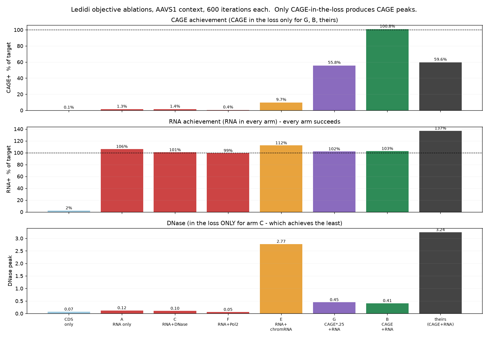

# borzoi-cage-necessity

**Is CAGE actually required to design synthetic gene-expression programs, or can RNA-seq alone do it?**

An independent computational audit of Borzoi/Ledidi regulatory sequence designs, built to answer one
question: when a design pipeline optimizes a sequence against both CAGE and RNA-seq predictions,
is the CAGE term doing necessary work, and can it be dropped or replaced with something cheaper?

Author: Advik Anand (<advikanand7@gmail.com>)
Date: 26 October 2026
Status: complete for the questions below; two items still open (see [Open questions](#open-questions))

---

## TL;DR

Six findings, in rough order of importance.

| # | Finding | Evidence |
|---|---|---|
| 1 | **CAGE is necessary in the design loss and nothing substitutes for it.** RNA-only reaches 1.3% of the CAGE target; CAGE+RNA reaches 100.8%. Substituting DNase (1.4%), Ser5-P Pol II (0.4%) or chromatin RNA (9.7%) all fail. | [Ablations](docs/06-objective-ablations.md) |
| 2 | **But CAGE is free at design time.** Borzoi predicts all 7,611 tracks in one forward pass, so a CAGE term costs nothing. CAGE only costs money if you *measure* it. The two questions had been conflated. | [Conclusions](docs/07-conclusions.md) |
| 3 | **No chromatin assay substitutes for CAGE in validation either.** Within one design family CAGE and DNase co-collapse (Pearson +0.942 to +0.998), but across designs from different objectives that drops to +0.218, and among CAGE-containing designs it is **−0.212**. An ATAC-only screen misreads **7 of 21** gene-design combinations, including all three genes of the best design. | [Track coupling](docs/04-context-robustness.md#track-coupling-can-a-chromatin-assay-stand-in-for-cage) |
| 4 | **Flanking context dominates everything.** The same design scores **437× differently** in random padding versus the real AAVS1 locus. Any result computed with random padding is suspect. | [Context robustness](docs/04-context-robustness.md) |
| 5 | **DNase is essentially not optimizable.** The arm that put DNase *in* the loss achieved the **lowest** DNase of any designed arm (0.100), below the arm that never mentioned it (0.408). | [Ablations](docs/06-objective-ablations.md) |
| 6 | **Same element, different nucleotides.** Scrambling a designed promoter destroys CAGE and DNase together ($r \approx 0.99$), but per-base ISM correlation between them is only −0.04 to +0.35. This explains why DNase is a good *readout* but a bad *objective*. | [ISM](docs/05-ism-mechanism.md) |

---

## The question

The source work (Pinglay lab, draft manuscript) designs ~20 kb synthetic loci carrying three
fluorescent-protein genes, using [Ledidi](https://github.com/jmschrei/ledidi) to edit a Markov-model
starting sequence so that [Borzoi](https://doi.org/10.1038/s41588-024-02053-6) predicts a specified
expression pattern. Its Figure 4 reports that designs reach their targets only when **CAGE and
RNA-seq are optimized jointly**, and that single-assay objectives fail:

| Objective | CAGE result | RNA result | DNase (never specified) |
|---|---|---|---|
| RNA alone | ~0.5 against 7/5/3 wanted | matches: 7.3 / 5.6 / 3.7 | flat, one spurious spike off-target |
| CAGE alone | matches: 28.8 / 21.7 / 12.1 | narrow spikes, no transcript body | runaway, broad peaks to 6.2, mostly off-target |
| CAGE + RNA | matches | matches | peaks **at** the designed positions |

Since CAGE is expensive to run experimentally, the practical question became: **can the same designs
be obtained, and validated, without CAGE?**

---

## Main results

### 1. Independent reproduction of the central claim

Identical initialization, identical iteration budget (600), identical genomic context, identical
targets. The only difference is whether CAGE appears in the loss.



| Arm | Objective | CAGE achieved | RNA achieved | DNase peak | Edits | Output MSE |
|---|---|---|---|---|---|---|
| A | RNA only | **1.3%** | 106.2% | 0.121 | 555 (3.1%) | 0.0691 |
| C | RNA + DNase | **1.4%** | 100.5% | 0.100 | 646 (3.6%) | 0.1336 |
| F | RNA + Ser5-P Pol II | **0.4%** | 99.3% | 0.055 | 972 (5.4%) | 0.3014 |
| E | RNA + chromatin RNA | **9.7%** | 112.2% | **2.774** | 1004 (5.6%) | 0.1179 |
| G | CAGE(×0.25) + RNA | 55.8% | 102.1% | 0.446 | 566 (3.2%) | 0.1543 |
| **B** | **CAGE + RNA** | **100.8%** | 102.7% | 0.408 | 689 (3.9%) | 0.0633 |
| — | lab's own design | 59.6% | 137.0% | 3.241 | 2909 total | — |
| — | CDS-only control | 0.1% | 2.4% | 0.068 | — | — |

**Undertraining does not explain the failures.** Arm B hit 100.8% within the same 600 iterations and
3.3 minutes, so the budget is demonstrably sufficient when the objective is right.

### 2. Why RNA alone fails

The RNA objective is nearly free to satisfy. **Every** arm reached 99–112% of the RNA target, and
arm A needed only 555 edits out of 17,847 mutable positions to get there. An objective satisfiable
from almost any direction cannot constrain the solution, so gradient descent never has to build
initiation machinery.

CAGE is the only term that does constrain it, and per-base ISM shows why no neighbour can stand in:
the bases that drive CAGE are not the bases that drive DNase or Pol II. They share the *element* but
not the *nucleotides*, and gradient descent follows nucleotides.


| Gene | r(CAGE, DNase) per base | CAGE centroid | DNase centroid |
|---|---|---|---|
| eGFP | +0.351 | −118 bp | −189 bp |
| mScarlet | −0.041 | −101 bp | −251 bp |
| RFP3 | +0.169 | −193 bp | −197 bp |

CAGE attribution centroids land at −101 to −193 bp against the designed TSS target of −128 bp, so
the optimizer does hit the specified position. The DNase centroid sits consistently 60–150 bp
further upstream, which is biologically sensible: core promoter drives initiation, flanking sequence
drives accessibility.

### 3. Motifs Ledidi installed

| Gene | New motif (absent in control) | Position | mean &#124;dCAGE&#124; | Window background | Verdict |
|---|---|---|---|---|---|
| RFP3 | **SP1 GC-box** | −123 | **2.258** | 0.449 | 5.0× background, functional |
| RFP3 | **SP1 GC-box** (− strand) | −92 | **2.027** | 0.449 | 4.5× background, functional |
| eGFP | KLF1 erythroid | −210 | 0.391 | 0.323 | 1.2×, marginal |
| mScarlet | TATAAA | −145 | 0.403 | 0.496 | 0.8×, **not** functional |

RFP3's two SP1 sites are the cleanest result, each created by single base changes
(control `GGGAGGG` becomes design `GGGCGGG`). No TATAAA sits at the canonical position in any gene,
and the one mScarlet acquired carries below-average attribution, so these remain functionally
TATA-less, CpG-enriched promoters (CpG o/e rises from 0.35–0.55 to 0.82–0.89 while GC stays at
47–50%).

### 4. Flanking context dominates (the most consequential methodological finding)

Borzoi requires a 524,288 bp input but the designs are 19,968 bp, so ~504 kb of padding is needed.
That choice is not neutral.

| Context | eGFP CAGE | mScarlet CAGE | RFP3 CAGE | eGFP RNA | RFP3 RNA |
|---|---|---|---|---|---|
| random, composition-matched, 3 seeds | 0.02–0.03 | 4.68–4.99 | 0.04–0.18 | 0.06–0.27 | 0.06–0.31 |
| all-N | 10.12 | 11.13 | 8.96 | 5.82 | 2.74 |
| **real AAVS1 locus** | **10.75** | **13.51** | **8.75** | **8.42** | **4.44** |

A **437× swing** for eGFP CAGE from padding alone. Three random seeds agree to within 2%, so this is
systematic rather than noise: long stretches of AT-rich random DNA read as dead chromatin and
suppress the construct. All substantive results in this repo therefore use the real AAVS1
safe-harbour locus (hg38 `chr19:54,862,840-55,387,128`), where such constructs actually integrate.

### 5. The designed promoters are necessary but not sufficient

| Test | CAGE | DNase | RNA |
|---|---|---|---|
| Scramble the three 600 bp promoters inside the design | **96–100% lost** | 87–100% lost | 84–92% lost |
| Transplant those promoters into the CDS-only control | 0–49% recovered | 0–61% recovered | **~1% recovered** |

Ledidi's other ~2,800 edits, spread across the construct, are doing required work. This argues
against a purely local reading of the oracle's behaviour.

### 6. Held-out tracks reveal a trade-off the headline numbers hide

Scored on tracks never present in any objective:

| Design | CAGE2+ | DNase2 | H3K4me3 | Pol2A | Ser5-P Pol2 |
|---|---|---|---|---|---|
| lab's design | 26.9 | 2.44 | 17.1 | 22.3 | 16.7 |
| B CAGE+RNA | **44.0** | 0.32 | 5.0 | 6.9 | 5.7 |
| E RNA+chromatin RNA | 4.0 | **2.34** | **15.6** | **19.5** | **18.5** |

Arm B wins on CAGE and loses badly on chromatin. Arm E, with no CAGE anywhere in its loss,
essentially matches the lab's design on accessibility, H3K4me3 and Pol II. The lab's design is the
only one that gets both, which is probably what its much longer optimization bought.
**CAGE + RNA + chromatin RNA** is the untested combination most worth running next.

---

## Recommendations

1. **Keep CAGE in the design loss.** It is computationally free, nothing substitutes for it, and
   removing it costs the entire phenotype.
2. **Drop CAGE from routine wet-lab validation. Use RNA-seq + ATAC.** Element-level Pearson coupling
   is 0.94–0.998, though rank correlation is only ~0.8 and one of the three genes (mScarlet) would be
   a false negative on ATAC alone. Assay CAGE once on two or three constructs to calibrate, then run
   RNA-seq + ATAC thereafter.
3. **Add an explicit antisense penalty.** Every arm here produced RNA+/RNA− of only 2.6–4.9 against
   the lab design's 59.7. Specifying only RNA+ lets the optimizer build bidirectional promoters.
4. **Design in the intended integration locus, not random padding.** Potentially a large and free
   improvement (see finding 4).
5. **Do not expect "add DNase to the loss" to fix accessibility.** It makes things worse.

---

## Repository layout

```
borzoi-cage-necessity/
├── README.md                     you are here
├── LICENSE                       MIT for code/, with data rights noted
├── docs/
│   ├── 01-source-material.md     the draft deck: structure, claims, internal conflicts
│   ├── 02-sequence-analysis.md   what the lab's sequences actually contain
│   ├── 03-cds-only-control.md    construction and verification of the control
│   ├── 04-context-robustness.md  flank sensitivity + promoter necessity/sufficiency
│   ├── 05-ism-mechanism.md       in-silico mutagenesis and installed motifs
│   ├── 06-objective-ablations.md the six Ledidi arms
│   ├── 07-conclusions.md         synthesis and recommendations
│   ├── 08-corrections.md         every claim retracted during this work, and why
│   └── 09-methods.md             full reproducible methods
├── figures/                      5 figures (PNG)
├── data/
│   ├── README.md                 index of every data file and its origin
│   ├── sequences/                lab originals + control + my 6 designed arms (FASTA)
│   ├── predictions/              all raw Borzoi outputs (JSON)
│   ├── context/                  the 524 kb AAVS1 flank, context metadata
│   └── tables/                   7 machine-readable result tables (CSV)
└── code/                         Modal app + all analysis scripts
```

### Result tables

| File | Contents |
|---|---|
`table1_context_robustness.csv` | 18 context × design combinations × 3 genes |
`table2_promoter_necessity_sufficiency.csv` | 9 perturbation arms × 3 genes × 5 tracks |
`table3_objective_ablations.csv` | the headline ablation table |
`table4_heldout_tracks.csv` | 11 held-out tracks × 9 designs |
`table5_designed_sequences.csv` | edit counts, GC, CpG o/e for every sequence |
`table6_ism_summary.csv` | ISM concentration, centroids, cross-track correlations |
`table7_borzoi_replicate_spread.csv` | per-replicate disagreement |
`table8_track_coupling.csv` | CAGE-vs-surrogate Pearson **and** Spearman, per gene, with value ranges |

---

## Reproducing

Requires a Modal account and a GPU (A100-80GB used throughout).

```bash
pip install -r code/requirements.txt
modal volume create borzoi-data
modal volume put borzoi-data data/context/aavs1_flank.txt /ctx/aavs1_flank.txt
# designs.json: {"initial": "...", "control": "...", "final": "...", ...}
modal volume put borzoi-data designs.json /ctx/designs.json

modal run code/borzoi_modal_app.py::main --step probe        # fidelity check
modal run code/borzoi_modal_app.py::main --step flank        # context robustness
modal run code/borzoi_modal_app.py::main --step arms  --flank aavs1,N,orig
modal run code/borzoi_modal_app.py::main --step ism   --flank aavs1 --rep 0
modal run code/borzoi_modal_app.py::main --step design \
  --arm A_rna,B_cage_rna,C_rna_dnase,E_rna_chrrna,G_cage_rna_dw,F_rna_pol2 --max-iter 600
modal run code/borzoi_modal_app.py::main --step score --flank aavs1
```

Total compute for everything in this repo: about **one A100-hour (~$3)**.

### Model fidelity

`borzoi-pytorch` replicate 0 was validated against the independently served Borzoi used for the
first runs: **Pearson 0.9988** over the 624 design bins, identical argmax bin (298). Peak amplitude
differs by 1.28× (5.94 versus 7.59), which is small next to Borzoi's own replicate spread on the
same sequence (7.59, 7.33, 19.86, 11.42 across replicates 0–3). All comparisons here are internal to
one model, so the offset does not affect any conclusion.

---

## Limitations

- **This is a model auditing a model.** Everything is Borzoi explaining Borzoi. It says what the
  objective does, not what cells do. No wet-lab validation.
- **Ledidi arms ran 600 iterations (~3.3 min) versus the lab's ~84 min.** Arm B reaching 100.8%
  shows the budget suffices when the objective is right, but the CAGE-free arms might improve with
  more iterations. Treat their failures as strong but not final.
- **Single replicate.** All designs used Borzoi replicate 0. Given the 2.7× replicate spread, peak
  magnitudes carry real model uncertainty.
- **Scrambling preserves mononucleotide but not dinucleotide composition,** so it destroys CpG. Some
  of the measured necessity may reflect CpG content rather than specific motifs. A
  dinucleotide-preserving shuffle is the better control and was not run.
- **The 600 bp promoter window is a choice.** Elements further upstream were not individually tested.
- **One context inconsistency:** `table1` (context robustness) was computed with strand-swapped
  reverse-complement averaging; everything else uses plain forward passes. Within-table comparisons
  are valid; do not compare absolute values across that boundary.
- **Motif identification is consensus matching, not a calibrated PWM scan.** Treat motif names as
  candidates.

---

## Open questions

1. **What flanking context does the lab's own pipeline use?** Given finding 4, this is the largest
   remaining uncertainty. Query sent, answer pending.
2. **What is the third fluorescent protein?** It is **not** HaloTag. See
   [sequence analysis](docs/02-sequence-analysis.md).
3. Would **CAGE + RNA + chromatin RNA** get both initiation precision and chromatin realism?
4. Does an explicit antisense penalty remove the bidirectionality defect without costing CAGE?

---

## Acknowledgements

The synthetic locus designs, the Markov initialization, the Ledidi optimization pipeline and the
draft manuscript analysed here are the work of the Pinglay lab. Thanks to Yash for sharing the
designs and the deck, and for confirming that the sequences are (+) strand. Ledidi is by
Jacob Schreiber; Borzoi is from Calico, with the PyTorch port by Johannes Hingerl.

This repository contains only my own independent follow-up analysis. Any errors are mine.

The lab's original sequences and the draft manuscript are unpublished and are **not** licensed for
redistribution; see [LICENSE](LICENSE). My code, analysis and figures are freely reusable.

## Software

| Tool | Version | Use |
|---|---|---|
[Borzoi](https://doi.org/10.1038/s41588-024-02053-6) | `borzoi-pytorch` 0.5.1 | sequence-to-function oracle |
[Ledidi](https://github.com/jmschrei/ledidi) | 2.2.0 | gradient-based sequence editing |
Modal | 1.5.4 | A100-80GB compute |
hg38 via UCSC REST API | — | AAVS1 flanking context |
