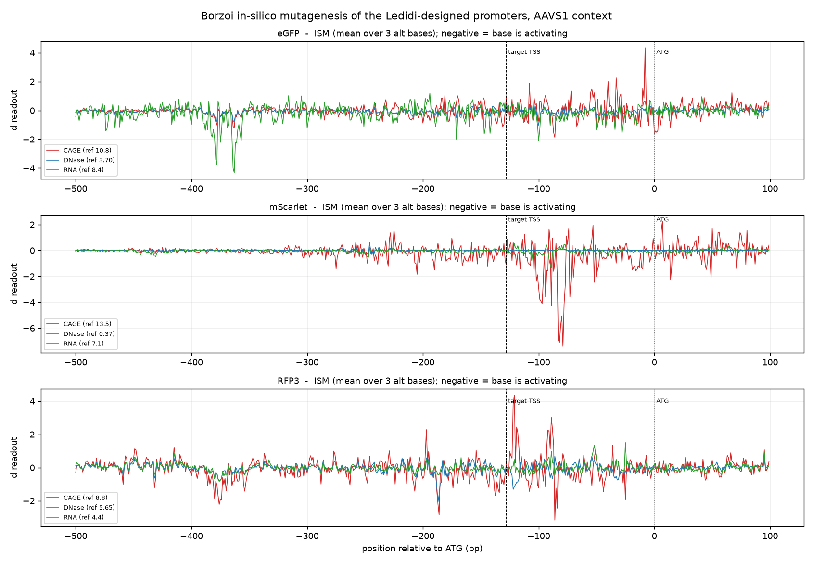

# 05. In-silico mutagenesis: what the designed promoters are made of

## Setup

5,400 single-base mutants: 3 genes × 600 positions (ATG − 500 to ATG + 100) × 3 alternative bases.
Real AAVS1 context, Borzoi replicate 0, bf16, 18 parallel Modal containers, 97 seconds total.

Readouts per mutant:
- **CAGE** peak over the promoter window
- **DNase** peak over the same window
- **RNA** mean over the CDS

Reported value is $\Delta = \text{mutant} - \text{reference}$, averaged over the three alternative
bases. **Negative means the base is activating** (mutating it reduces the readout).



## The central result: same element, different nucleotides

| Gene | ref CAGE | r(CAGE, DNase) | r(CAGE, RNA) | r(DNase, RNA) |
|---|---|---|---|---|
| eGFP | 10.75 | +0.351 | +0.213 | +0.758 |
| mScarlet | 13.51 | **−0.041** | −0.031 | +0.359 |
| RFP3 | 8.75 | +0.169 | +0.583 | +0.466 |

Compare against the element-level correlations from [04](04-context-robustness.md), which were
+0.942 to +0.998 for the same pair of tracks.

**Scrambling the whole 600 bp window destroys CAGE and DNase together. Within that window, the
individual bases driving CAGE are largely not the bases driving DNase.** They share the element but
not the nucleotides.

This single observation reconciles the two halves of the project:

- **Validation operates at element level.** DNase/ATAC is an excellent CAGE surrogate for detecting
  whether an element fired (though see [04](04-context-robustness.md) for its weaker rank behaviour
  and the mScarlet false negative).
- **Design operates at base level.** Gradients from a DNase term point somewhere else, so DNase
  cannot substitute for CAGE in the loss. Confirmed empirically in [06](06-objective-ablations.md).

## Spatial organization

| Gene | CAGE centroid | DNase centroid | RNA centroid | CAGE spread (sd) |
|---|---|---|---|---|
| eGFP | −118 bp | −189 bp | −234 bp | 138 bp |
| mScarlet | −101 bp | −251 bp | −162 bp | 114 bp |
| RFP3 | −193 bp | −197 bp | −196 bp | 153 bp |

CAGE attribution centres on the designed TSS target of −128 bp for eGFP and mScarlet. The DNase
centroid sits consistently **60–150 bp further upstream** than CAGE's, which is the expected
architecture: core promoter drives initiation, flanking sequence drives accessibility.

Attribution is only moderately concentrated (Gini 0.46–0.63; top 20 positions carry 15–30% of total
attribution), consistent with distributed rather than single-motif control.

## Motifs Ledidi installed

Motifs present in the designed window and absent from the control, both strands, weighted by
attribution. Window background mean |dCAGE| given for comparison.

| Gene | Motif | Position | mean &#124;dCAGE&#124; at site | Background | Ratio |
|---|---|---|---|---|---|
| RFP3 | **SP1 / KLF GC-box** (+) | −123 | **2.258** | 0.449 | **5.0×** |
| RFP3 | **SP1 / KLF GC-box** (−) | −92 | **2.027** | 0.449 | **4.5×** |
| RFP3 | TATAAA (−) | −258 | 0.182 | 0.449 | 0.4× |
| eGFP | KLF1 erythroid `CCMCRCCC` (−) | −210 | 0.391 | 0.323 | 1.2× |
| mScarlet | SP1 core (+) | −346 | 0.053 | 0.496 | 0.1× |
| mScarlet | TATAAA (+) | −145 | 0.403 | 0.496 | **0.8×** |

### RFP3's SP1 sites are the cleanest designed elements found

Each was created by a single base change:

```
control:  ATGCTATGGGAGGGACT
design:   AGCCTATGGGCGGGACC
                     ^
                  G -> C creates GGGCGG
```

Both carry 4.5–5× the window's average attribution.

### The TATA boxes are not functional

mScarlet acquired a `TATAAA` 17 bp upstream of its designed TSS. It carries **below-background**
attribution (0.403 against 0.496), so it is an incidental hexamer rather than a designed element.
No gene has a TATAAA at the canonical core-promoter position in any of the three sequences. These
remain functionally TATA-less, CpG-enriched promoters:

| Gene | control GC / CpG o/e | design GC / CpG o/e |
|---|---|---|
| eGFP | 47.5% / 0.52 | 50.3% / **0.87** |
| mScarlet | 43.0% / 0.55 | 46.8% / **0.82** |
| RFP3 | 46.0% / 0.35 | 48.2% / **0.89** |

CpG o/e nearly doubles or triples while GC moves only 2–4 points. That is a CpG-island signature
without the GC-richness, which is exactly how many TATA-less mammalian promoters look.

## Different readouts, different elements

eGFP's RNA attribution has its own hotspot at −355 to −390, well separated from its CAGE hotspot
near −100. Ledidi edited 25% of the bases in a 40 bp window there:

```
control:  GAAAGGGATGGTGAAAGGACTAATGATGTCTCCAGAGACT
design:   GAAAAGAATGGCGAACGGACTAAAGACGTCACCGGCAACT
```

The design contains `GACGTCA` (CREB/ATF-like) and `ATGGCG` (YY1-like core), neither present in the
control. So the optimizer is building separate elements for separate readouts, which is consistent
with the low per-base cross-track correlations.

## Caveats

- Motif identification is IUPAC consensus matching, not a calibrated PWM or TOMTOM scan. Treat names
  as candidates.
- Single replicate (rep 0). Given the 2.7× replicate spread, magnitudes are uncertain.
- Single-base ISM understates the contribution of redundant or cooperative elements.

Data: `data/predictions/ism_aavs1_rep0.json`, `data/tables/table6_ism_summary.csv`.
