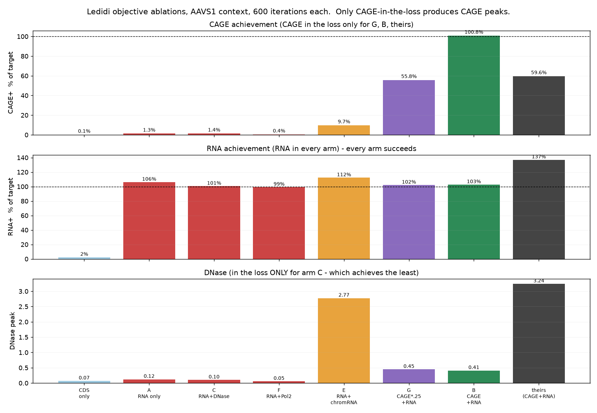
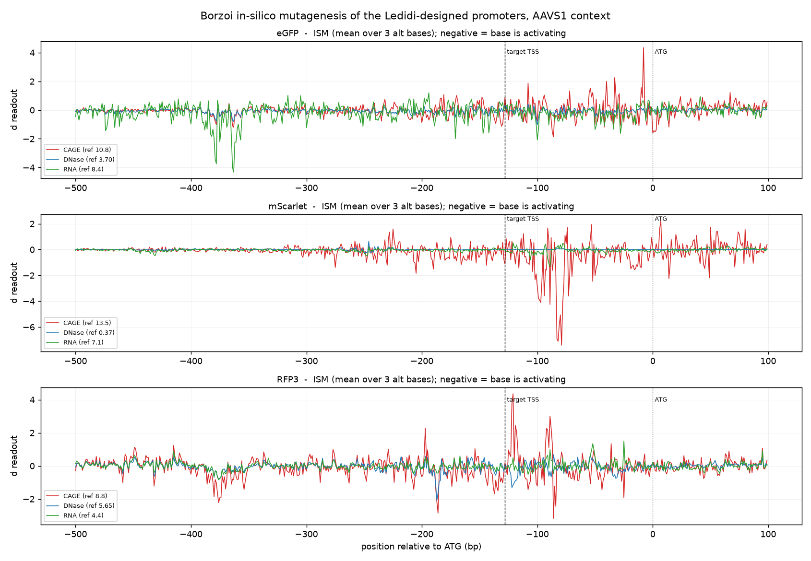

# 16 — Early exploration: the CAGE-necessity question

This was the project's original framing, before the authors clarified that **DNase peaks at promoters** is the real target. It is kept in full because the controls here are load-bearing for everything later: the CDS-only control, the flanking-context result, and the necessity/sufficiency tests all come from this phase.

Read the [README](../README.md) first. Several claims below are superseded; each is flagged in [docs/08](08-corrections.md).

## The original question

The source work (Pinglay lab, draft manuscript) designs ~20 kb synthetic loci carrying three
fluorescent-protein genes, using [Ledidi](https://github.com/jmschrei/ledidi) to edit a Markov-model
starting sequence so that [Borzoi](https://doi.org/10.1038/s41588-024-02053-6) predicts a specified
expression pattern. Its Figure 4 reports that designs reach their targets only when **CAGE and
RNA-seq are optimized jointly**, and that single-assay objectives fail:

| Objective | CAGE result | RNA result | DNase (never specified) |
|---|---|---|---|
| RNA alone | ~0.5 against 7/5/3 wanted | matches: 7.3 / 5.6 / 3.7 | flat, one spurious spike off-target |
| CAGE alone | matches: 28.8 / 21.7 / 12.1 | narrow spikes, no transcript body | runaway, broad peaks to 6.2, mostly off-target |
| CAGE + RNA | matches | matches | peaks **at** the designed positions |

Since CAGE is expensive to run experimentally, the practical question became: **can the same designs
be obtained, and validated, without CAGE?**

---

## Results from that phase

### 1. Independent reproduction of the central claim

Identical initialization, identical iteration budget (600), identical genomic context, identical
targets. The only difference is whether CAGE appears in the loss.

| Arm | Objective | CAGE achieved | RNA achieved | DNase peak | Edits | Output MSE |
|---|---|---|---|---|---|---|
| A | RNA only | **1.3%** | 106.2% | 0.121 | 555 (3.1%) | 0.0691 |
| C | RNA + DNase | **1.4%** | 100.5% | 0.100 | 646 (3.6%) | 0.1336 |
| F | RNA + Ser5-P Pol II | **0.4%** | 99.3% | 0.055 | 972 (5.4%) | 0.3014 |
| E | RNA + chromatin RNA | **9.7%** | 112.2% | **2.774** | 1004 (5.6%) | 0.1179 |
| G | CAGE(×0.25) + RNA | 55.8% | 102.1% | 0.446 | 566 (3.2%) | 0.1543 |
| **B** | **CAGE + RNA** | **100.8%** | 102.7% | 0.408 | 689 (3.9%) | 0.0633 |
| — | lab's own design | 59.6% | 137.0% | 3.241 | 2909 total | — |
| — | CDS-only control | 0.1% | 2.4% | 0.068 | — | — |

**Undertraining does not explain the failures.** Arm B hit 100.8% within the same 600 iterations and
3.3 minutes, so the budget is demonstrably sufficient when the objective is right.

### 2. Why RNA alone fails

The RNA objective is nearly free to satisfy. **Every** arm reached 99–112% of the RNA target, and
arm A needed only 555 edits out of 17,847 mutable positions to get there. An objective satisfiable
from almost any direction cannot constrain the solution, so gradient descent never has to build
initiation machinery.

CAGE is the only term that does constrain it, and per-base ISM shows why no neighbour can stand in:
the bases that drive CAGE are not the bases that drive DNase or Pol II. They share the *element* but
not the *nucleotides*, and gradient descent follows nucleotides.

| Gene | r(CAGE, DNase) per base | CAGE centroid | DNase centroid |
|---|---|---|---|
| eGFP | +0.351 | −118 bp | −189 bp |
| mScarlet | −0.041 | −101 bp | −251 bp |
| RFP3 | +0.169 | −193 bp | −197 bp |

CAGE attribution centroids land at −101 to −193 bp against the designed TSS target of −128 bp, so
the optimizer does hit the specified position. The DNase centroid sits consistently 60–150 bp
further upstream, which is biologically sensible: core promoter drives initiation, flanking sequence
drives accessibility.

### 3. Motifs Ledidi installed

| Gene | New motif (absent in control) | Position | mean &#124;dCAGE&#124; | Window background | Verdict |
|---|---|---|---|---|---|
| RFP3 | **SP1 GC-box** | −123 | **2.258** | 0.449 | 5.0× background, functional |
| RFP3 | **SP1 GC-box** (− strand) | −92 | **2.027** | 0.449 | 4.5× background, functional |
| eGFP | KLF1 erythroid | −210 | 0.391 | 0.323 | 1.2×, marginal |
| mScarlet | TATAAA | −145 | 0.403 | 0.496 | 0.8×, **not** functional |

RFP3's two SP1 sites are the cleanest result, each created by single base changes
(control `GGGAGGG` becomes design `GGGCGGG`). No TATAAA sits at the canonical position in any gene,
and the one mScarlet acquired carries below-average attribution, so these remain functionally
TATA-less, CpG-enriched promoters (CpG o/e rises from 0.35–0.55 to 0.82–0.89 while GC stays at
47–50%).

### 4. Flanking context dominates (the most consequential methodological finding)

Borzoi requires a 524,288 bp input but the designs are 19,968 bp, so ~504 kb of padding is needed.
That choice is not neutral.

| Context | eGFP CAGE | mScarlet CAGE | RFP3 CAGE | eGFP RNA | RFP3 RNA |
|---|---|---|---|---|---|
| random, composition-matched, 3 seeds | 0.02–0.03 | 4.68–4.99 | 0.04–0.18 | 0.06–0.27 | 0.06–0.31 |
| all-N | 10.12 | 11.13 | 8.96 | 5.82 | 2.74 |
| **real AAVS1 locus** | **10.75** | **13.51** | **8.75** | **8.42** | **4.44** |

A **437× swing** for eGFP CAGE from padding alone. Three random seeds agree to within 2%, so this is
systematic rather than noise: long stretches of AT-rich random DNA read as dead chromatin and
suppress the construct. All substantive results in this repo therefore use the real AAVS1
safe-harbour locus (hg38 `chr19:54,862,840-55,387,128`), where such constructs actually integrate.

### 5. The designed promoters are necessary but not sufficient

| Test | CAGE | DNase | RNA |
|---|---|---|---|
| Scramble the three 600 bp promoters inside the design | **96–100% lost** | 87–100% lost | 84–92% lost |
| Transplant those promoters into the CDS-only control | 0–49% recovered | 0–61% recovered | **~1% recovered** |

Ledidi's other ~2,800 edits, spread across the construct, are doing required work. This argues
against a purely local reading of the oracle's behaviour.

### 6. Held-out tracks reveal a trade-off the headline numbers hide

Scored on tracks never present in any objective:

| Design | CAGE2+ | DNase2 | H3K4me3 | Pol2A | Ser5-P Pol2 |
|---|---|---|---|---|---|
| lab's design | 26.9 | 2.44 | 17.1 | 22.3 | 16.7 |
| B CAGE+RNA | **44.0** | 0.32 | 5.0 | 6.9 | 5.7 |
| E RNA+chromatin RNA | 4.0 | **2.34** | **15.6** | **19.5** | **18.5** |

Arm B wins on CAGE and loses badly on chromatin. Arm E, with no CAGE anywhere in its loss,
essentially matches the lab's design on accessibility, H3K4me3 and Pol II. The lab's design is the
only one that gets both, which is probably what its much longer optimization bought.
**CAGE + RNA + chromatin RNA** is the untested combination most worth running next.

---
